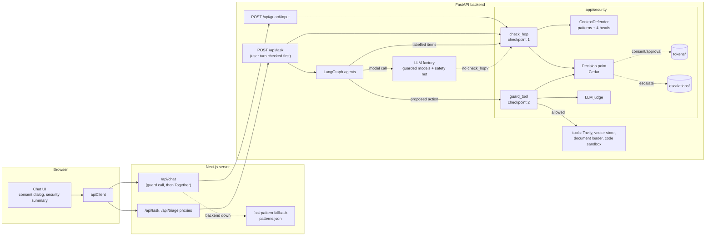
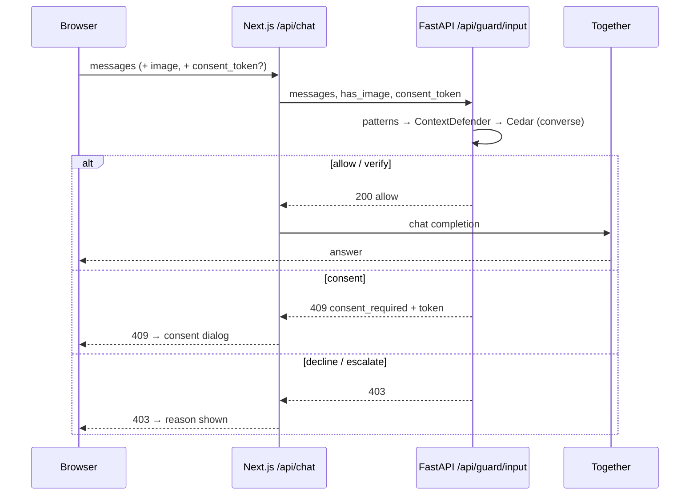
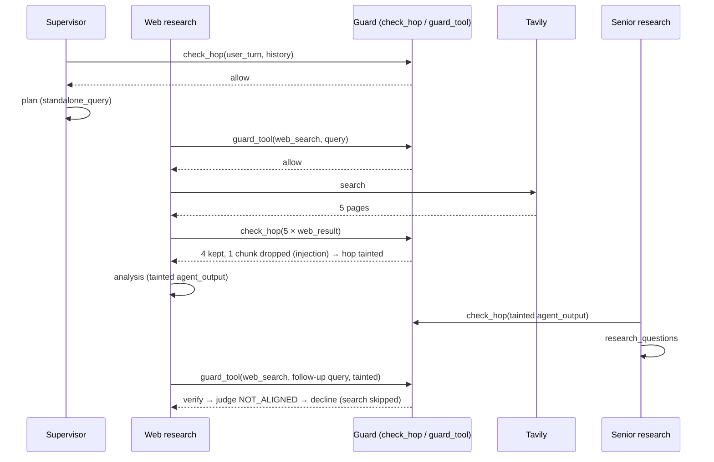

# High-level design: security checkpoints

This document shows the parts of the system, how each checkpoint works on each kind of input, what happens when something fails, and why the main choices were made. Module details are in the two low-level designs. Requirement IDs refer to [`requirements.md`](requirements.md).

## 1. Components

| Component | Owner | Responsibility |
|---|---|---|
| ContextDefender | Backend | Score context items: patterns, 4 calibrated heads, `threat_risk`. Never decides |
| Decision point | Backend | Evaluate Cedar policies for a request; return outcome + policy ids |
| `check_hop` (checkpoint 1) | Backend | Per hop: score items, ask the decision point, return kept items and taint |
| LLM factory safety net | Backend | Catch model calls without `check_hop`; score the prompt's variable part as `unlabelled` |
| `guard_tool` (checkpoint 2) | Backend | Per tool action: deterministic checks, alignment, taint → decision → run or skip |
| LLM judge | Backend | Settle `verify` at checkpoint 2 from the task text and the proposed call only |
| `/api/guard/input` | Backend | Checkpoint 1 for the web app's direct chat |
| `/api/chat` guard call | Web server | Call the guard before Together; fall back to fast patterns |
| Consent dialog, summary | Browser | Ask for consent; show what was dropped or skipped; offer approval |

## 2. Sources and trust

| Source | Where it comes from | Trust | Typical policy |
|---|---|---|---|
| `user_turn` | The current message | Medium | Decline only on high harm; consent on jailbreak |
| `history` | Client-sent earlier messages (both roles) | Low-medium | Like `user_turn` for harm; never a reason to send data out |
| `agent_output` | Another agent's output in this task | Inherits taint | Checked like any item; taint carries |
| `web_result` | Tavily | Low | Drop on injection ≥ the model's drop threshold (40 by default) or injection patterns; taint from the watch threshold (20) up |
| `retrieved_doc` | Vector store | Low-medium | As `web_result` |
| `document` | Uploaded file | Low-medium | As `web_result` |
| `tool_output` | Code execution output | Low | As `web_result` |
| `image` | Attached image | Not scored | Recorded only |
| `unlabelled` | Safety net | Low | As `web_result` |

## 3. Flows

### 3.1 Direct chat (Off, Auto-direct, task fallback)

If the guard can't be reached, Next.js runs the fast patterns from its copy of `patterns.json`: a hit is refused, anything else continues with the existing fallback notice (decided).

### 3.2 Agentic task

1. `POST /api/task` runs checkpoint 1 on the user turn and `previous_messages` **before creating the task**. Consent, decline and escalate are answered at once (SEC-033).
2. Each agent builds its prompt from labelled items and calls `check_hop`. Kept items go into the prompt; dropped chunks are left out and recorded; the hop's taint is set.
3. When an agent is about to use a tool, it calls `guard_tool(action, args, state)`. The deterministic checks, alignment and taint go into the Cedar context; the outcome decides whether the tool runs.
4. Tool output (for example code output) is a new `tool_output` item for the next hop, so checkpoint 1 sees it.
5. The task result carries the `security` block.

### 3.3 Consent and approval

- **User turn:** `409` with a consent token → dialog → resend with the token → `consented = true`, task tainted (SEC-050).
- **Tool action:** the action is skipped and listed in `security.approvals` with an approval token → "Approve and re-run" → the same task again with `approval_tokens` → that tool is in `approved_tools` for the re-run (SEC-051). A re-run makes new LLM calls, so the approval covers the tool in that task, not one exact call. Approval never overrides decline or escalate (SEC-052).

## 4. Outcomes

| Outcome | User turn / history | Untrusted item | Tool action |
|---|---|---|---|
| allow | Continue | Keep | Run |
| verify | Harm/jailbreak band: LLM judge → decline, consent or allow; else continue, task tainted | Keep, hop tainted | LLM judge (decline if the judge is off) |
| consent | 409 + token | Not allowed (policy lint) | Skip; offer approval |
| decline | 403 | Drop flagged chunks; hop tainted | Skip; continue |
| escalate | 403; record | Drop item; record; continue | Stop the task; record |

Severity when several policies match: escalate > decline > consent > verify > allow.

## 5. Taint

- Set when a hop keeps an untrusted item with outcome `verify`, or drops any part of an untrusted item.
- Task-wide: once any hop is tainted, the task's ledger is tainted and every later hop and tool action in the task sees `tainted = true`, whether or not it reads the tainted hop's output. The hop's outputs are also marked (`agent_output` items with `tainted = true`). This is stricter than tracking which outputs each hop read, and simpler to get right with parallel agents.
- Lasts until the task ends; a consented user turn taints the whole task.
- At checkpoint 2, `tainted = true` makes search policies require alignment and code policies require approval.
- Parallel research agents' taint is merged back with OR (SEC-039).

## 6. Failure handling

| Failure | Behavior | Why |
|---|---|---|
| ContextDefender can't load | Patterns still run; `scores_available = false`; untrusted items kept but tainted | Research keeps working; checkpoint 2 gets stricter |
| Decision point error | Checkpoint 1: drop untrusted items, allow user turns. Checkpoint 2: decline code, allow search/retrieval | Fail closed where the action is dangerous, open where blocking is worse than the risk |
| Guard unreachable from Next.js, or answering 401/422/5xx | Fast patterns, then fail open with notice (errors also logged) | Off mode didn't need the backend before (decided); a broken guard mustn't take the chat down |
| Judge timeout or error | Tools: `NOT_ALIGNED`. User turns: verify stands (continue, tainted) | A skipped search costs less than a leaked one; a wrongly refused question costs more than a tainted task |
| Token store unavailable | No consent, no approval | Fail closed on permissions |
| Policy file invalid at startup | uat/prod: refuse to start; dev: shadow with an error | Same rule as the triage model files |

## 7. Data

| Data | Where | In git | User text |
|---|---|---|---|
| Curated training, test and probe sets | `backend/data/security/{train,test,probe}.jsonl` | Yes | No (reviewed) |
| Model (heads, calibrators, TF-IDF vocabulary) | `backend/models/security/` (`heads.joblib`, `metadata.json`) | Yes (small) | No |
| Encoder | Base MiniLM, baked into the image (see deployment) | No | No |
| Policies, schema, policy tests, patterns, source weights | `backend/config/security/` | Yes | No |
| Collected decisions | `backend/data/security/collected/` | No (ignored) | Yes; 30 days |
| Escalations | `backend/data/security/escalations/` | No (ignored) | Dev only; 30 days |
| Used token IDs | `backend/data/security/tokens/` | No (ignored) | No |
| Security block | Task results, chat responses | n/a | No (URLs/titles only) |

## 8. Deployment

- **Image:** ContextDefender needs the base `all-MiniLM-L6-v2`, while the triage encoder is the fine-tuned copy in `models/triage/encoder/`. The base encoder is downloaded at build time into `/opt/models` (`SENTENCE_TRANSFORMERS_HOME`), as 3.1.x did, not under `/app/data`, which is a mounted volume. About 90 MB more image.
- **Memory:** a second encoder per worker, about 90 MB, so a worker with triage and ContextDefender is about 770 MB. Two workers need the Kubernetes limit raised to **2 GiB**, with a 1.5 GiB request (decided; SNFR-05 measures it).
- **Image size (open):** with both encoders the image is about 175 MB larger than 3.0.3, past the triage spec's NFR-09 budget of 100 MB. Recommendation in the README: raise that budget to 200 MB, and revisit one shared encoder after phase 2.
- **Runtime folders** on the data volume: `security/collected/`, `security/escalations/`, `security/tokens/`, shared by the workers.
- **Next.js** needs no new secrets; it already holds `WEBAGENT_API_KEY` for the proxy. Its copy of `patterns.json` ships with the web app.
- **Dependency:** `cedarpy` wheels must exist for Python 3.12 on Linux amd64 and arm64 (phase 0 spike).

## 9. Key decisions

| # | Decision | Why | Rejected |
|---|---|---|---|
| H1 | The classifier scores, policies decide | Thresholds change without retraining; every decision has a policy id | Classifier with built-in thresholds |
| H2 | Cedar in-process (`cedarpy`) | Readable, testable policies; one engine for both checkpoints; ~0.2 ms | A YAML rules file (no validation, weaker semantics); a policy service (network hop) |
| H3 | Score items at prompt-building time (`check_hop`) | Only way to skip template text and drop one chunk | Score the formatted prompt in the LLM wrapper only |
| H4 | Safety net in the LLM factory | A forgotten `check_hop` is still checked and counted | Trust every agent to call it |
| H5 | User turn checked before the task exists | An async task can't ask for consent | Check inside the supervisor hop |
| H6 | Approval per tool per task | Re-runs aren't deterministic | Approval per exact call |
| H7 | Frozen encoder + calibration | Policies need graded scores; the triage fine-tune scores were almost all 0 or 1 | Fine-tuned encoder first |
| H8 | Checkpoint 2 first | No model needed; guards the harmful actions; gives the red-team suite a target | Checkpoint 1 first |
| H9 | Shadow mode first | Thresholds from real traffic | Ship acting |
| H10 | Direct chat calls the backend, with a pattern fallback | Server-side, can't be skipped by the browser; Off mode stays usable when the backend is down | Guard only the agentic path |

## 10. Known limitations

- Images are not scored.
- The final answer has no output checkpoint; injected pages can still influence the report through chunks that weren't flagged.
- Escalation is a review queue; there are no accounts to block.
- The fast-pattern fallback in Next.js is much weaker than the classifier; it only applies when the backend is down.
- Approval is per tool per task, so an approved re-run allows any call of that tool that passes the decline policies.
