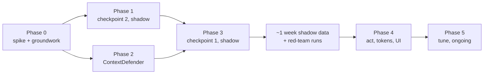

# Tasks: security checkpoints

Each phase ends with all tests passing and can ship on its own (checkpoints stay in shadow mode until phase 4). Each task lists what it covers, what it depends on, and when it is done. Estimates are in working hours (h); a day is 8 h.

Rules for every task:

- Add or update tests in the same change. Run `npm run test`, `npm run check-types`, `npm run lint` and `python -m pytest backend/tests` before marking it done.
- No raw context text in logs, metrics or results outside dev.
- Every new or changed policy gets a row in `policy_tests.yaml`.
- Update `CHANGELOG.md` at the end of each phase.

Phases 1 and 2 can run in parallel. Total for phases 0–4: about 140 h (≈ 18 working days), plus the shadow week.

## Phase 0: spike and groundwork (~2.5 d; 18 h)

| ID | Task | Covers | Depends | Done when | Est. |
|---|---|---|---|---|---|
| 0.1 | `cedarpy` in the backend image: wheels for Python 3.12 on Linux amd64 and arm64; pick a release at least two weeks old; licence check; pin in `requirements.txt` and `constraints.txt` | SEC-010, SNFR-07 | — | `docker build` passes on both architectures; `python -c "import cedarpy"` in the container | 3 h |
| 0.2 | Route every LLM entry point through `services/llm.py`: internal research's `get_llm` retry, the coding agents' `ChatOpenAI`, `openai` client and `get_llm_without_tags`. Coding agents get `get_agent_llm("coding_assistant" / "coding_review")` with an OpenAI provider option | SEC-001 | — | Existing agent tests pass; coding agents work with and without an OpenAI key | 6 h |
| 0.3 | `get_trusted_llm()`; triage tie-breaker and the diagnostics health check switched to it; `get_llm`/`get_llm_without_tags` made private; `test_llm_entry_points.py` | SEC-001, SEC-002 | 0.2 | The entry-point test fails on a planted `ChatOpenAI` import and passes on the codebase | 2 h |
| 0.4 | Red-team skeleton (`tests/redteam/`): a fake Tavily serving poisoned pages, fake documents with hidden text, forged history, and a scripted "obedient" fake LLM that follows injected instructions (so a passing test proves the guard stopped it) | SNFR-03, SNFR-08 | — | One end-to-end test runs offline and, with no guard yet, shows the exfiltrating search happening | 4 h |
| 0.5 | `SecurityGuardConfig`, `security_guard:` YAML sections, `WEBAGENT_GUARD_*` overrides | SEC-063 | — | pytest: YAML values, each override, bad values warn | 3 h |

## Phase 1: checkpoint 2, deterministic, shadow (~4 d; 32 h)

| ID | Task | Covers | Depends | Done when | Est. |
|---|---|---|---|---|---|
| 1.1 | `types.py`; `ledger.py` (hops, taint, counters, `merge`) | SEC-039 | 0.5 | pytest: merge of two ledgers | 3 h |
| 1.2 | `decision.py`: load, annotation map, lint (incl. SEC-052 and no consent for untrusted sources), schema validation, `policy_tests.yaml`, `decide()` with defaults and severity; `policies.cedar` with the 15 starting policies and their test rows | SEC-010–SEC-014, SEC-052 | 0.1 | `test_security_decision.py` passes; a broken policy fails loading | 5 h |
| 1.3 | `patterns.py` + `config/security/patterns.json`: the full `pattern_hits` vocabulary (context-item and tool-argument patterns), with the user-turn exception for tool arguments | SEC-021 (tool part), SEC-041 | — | `test_security_patterns.py` table passes | 3 h |
| 1.4 | `code_checks.py` | SEC-043 | — | `test_security_code_checks.py` table passes | 3 h |
| 1.5 | `alignment.py` with the base MiniLM (shared loader that ContextDefender reuses in phase 2) | SEC-044 | — | pytest: on-task query high, exfiltrating query low | 2 h |
| 1.6 | `tool_guard.py` and the hooks at every call site (3 searches, 2 retrievals, document load, every code execution attempt); shadow mode; decline counter; document provenance | SEC-040, SEC-042, SEC-046, SEC-047, SEC-062 | 1.1–1.5 | `test_security_tool_guard.py` passes, including "tool not called after decline" in act mode | 5 h |
| 1.7 | Metrics, decision log lines, the tool parts of the `security` block on results | SEC-080, SEC-081, SEC-082 | 1.6 | pytest reads the registry; `caplog` shows no text outside dev | 3 h |
| 1.8 | `records.py`: escalation queue, collection, daily cleanup; `.gitignore` entries | SEC-060, SEC-064 | 1.6 | `test_security_records.py` passes | 3 h |
| 1.9 | Startup check for policies; Dockerfile bakes the base MiniLM into `/opt/models` again (ContextDefender and alignment need it) | SEC-014, SEC-065 | 1.2 | uat/prod refuse to start with a broken policy file; image size recorded | 2 h |
| 1.10 | Red-team cases for exfiltrating searches and network code; benign regression through checkpoint 2 (in act mode inside the test) | SNFR-03, SNFR-04 | 0.4, 1.6 | Zero exfiltrating searches and zero network code executed; benign false declines < 0.5% | 3 h |

## Phase 2: ContextDefender (~4–5 d; 32 h)

| ID | Task | Covers | Depends | Done when | Est. |
|---|---|---|---|---|---|
| 2.1 | `data/security/README.md`; choose public sets with compatible licences, record each (name, licence, link, rows used); import and map to the four axes | SEC-027 | — | README reviewed; no non-commercial set used | 4 h |
| 2.2 | `scripts/fetch_security_sources.py` and `scripts/build_security_dataset.py`: public attacks placed per source (injections inserted into real benign pages with their `span`; injections and jailbreaks as history turns), generated non-adversarial rows (fake secrets in configs and logs, program output), benign negatives (WildChat, triage questions, safe prompts). No hand-written adversarial text | SEC-027 | 2.1 | Rows in `train.jsonl` with `origin` set | 6 h |
| 2.3 | Held-out `test.jsonl` and `probe.jsonl`, split by near-duplicate cluster, with one source held out for each (BIPIA for test, treycsa for probe); `--check-data` with `REQUIRED_CELLS` | SEC-027 | 2.2 | `eval_context_defender.py --check-data` passes (no near-copies ≥ 0.9) | 4 h |
| 2.4 | `scripts/security_data.py`, `scripts/train_context_defender.py`: router, chunker, featurizers, optional encoder fine-tuning, hard-negative weights, heads, calibration, per-axis thresholds | SEC-022, SEC-023, SEC-024, SEC-028a | 2.2 | Training smoke test with a fake encoder; real run < 5 min | 6 h |
| 2.5 | `scripts/eval_context_defender.py`: per-axis and per-source metrics, ECE, the gate, `--write-metadata` | SEC-024, SEC-028 | 2.4 | Exit-code test above and below the targets | 4 h |
| 2.6 | `context_defender.py` runtime: lazy load with back-off, warm-up, cache, pooling, `threat_risk` with `source_weights.yaml`, context-item patterns first, `scores_available` | SEC-020, SEC-021, SEC-025, SEC-026 | 2.4, 1.3 | `test_context_defender.py` passes | 5 h |
| 2.7 | Train v1, run the gate and the probe set, commit artifacts; measure p95 latency per hop and memory per worker | SEC-028, SNFR-01, SNFR-05, SNFR-06 | 2.3, 2.5, 2.6 | Gate passes, or the gap is written down with a plan; numbers recorded in the spec README | 3 h |

## Phase 3: checkpoint 1, shadow (~4–5 d; 32 h)

| ID | Task | Covers | Depends | Done when | Est. |
|---|---|---|---|---|---|
| 3.1 | `hop_guard.check_hop`: per-item decisions, outcomes by source, chunk dropping, taint rules, images, `CURRENT_HOP` | SEC-031, SEC-035, SEC-036, SEC-037, SEC-038 | 1.1, 1.2, 2.6 | `test_security_hop_guard.py` passes | 6 h |
| 3.2 | Per-agent integration: labelled items and `check_hop` in the supervisor (and `answer_directly`), web research, internal research, senior research, document extraction, coding assistant, coding review (execution output as `tool_output`), data analysis, team manager; `register_template` for each prompt | SEC-030, SEC-031 | 3.1, 0.2 | pytest per agent: a flagged chunk is absent from the formatted prompt; templates aren't scored | 8 h |
| 3.3 | `GuardedModel` safety net and `webagent_guard_unlabelled_total` | SEC-032 | 3.1 | pytest: a call without `check_hop` is scored as `unlabelled` and counted | 3 h |
| 3.4 | Merge security ledgers after `run_research_agents` | SEC-039 | 1.1, 3.2 | pytest with two fake parallel agents | 1 h |
| 3.5 | `/api/task` intake check on the user turn and history before the task is created (shadow: recorded, not applied) | SEC-033 | 3.1 | `test_task_guard.py` intake cases pass | 2 h |
| 3.6 | `POST /api/guard/input` | SEC-034 | 3.1 | `test_guard_endpoint.py` passes | 2 h |
| 3.7 | Next.js: `callGuard`, the `/api/chat` guard call and fallback, `patterns.json` copy and `guardPatterns.ts`, the sync test | SEC-090, SEC-091 | 3.6 | `chatGuard.test.ts` and `patternsSync.test.ts` pass | 3 h |
| 3.8 | Startup check for the ContextDefender model and gate; Kubernetes memory limit 2 GiB (request 1.5 GiB); measure two workers in the container | SEC-065, SNFR-05 | 2.7 | Container starts offline with both models; memory within 2 GiB with 20% headroom | 2 h |
| 3.9 | LangSmith metadata; Grafana panel (decisions by checkpoint and outcome, p95 latency, escalations) | SEC-083, SEC-084 | 1.7 | Panel added; screenshot in the PR | 2 h |
| 3.10 | Red-team: poisoned pages, hidden-text documents, forged history, through checkpoint 1 (act mode inside the test); benign regression through both checkpoints; latency per hop | SNFR-01, SNFR-03, SNFR-04 | 3.2, 1.10 | Zero exfiltrating searches and unsafe code; benign false declines < 0.5%; p95 < 150 ms per hop | 3 h |

**Shadow week (calendar time, ~0.5 d of work):** run both checkpoints in shadow mode on real use for about a week, plus repeated red-team runs. Review collected decisions, set the policy thresholds from the score distributions, and add every miss to the red-team suite. Exit criterion: with the tuned thresholds replayed on the week's decisions, benign false declines < 0.5% and every red-team case stopped.

## Phase 4: act, tokens, UI (~3–4 d; 25 h)

| ID | Task | Covers | Depends | Done when | Est. |
|---|---|---|---|---|---|
| 4.1 | `tokens.py`: issue, redeem, `TokenStore` with `O_EXCL` claims, cleanup | SEC-050, SEC-051, SEC-053 | 0.5 | `test_security_tokens.py` passes (two stores on one folder) | 4 h |
| 4.2 | `/api/task`: 409/403 answers, `consent_token` and `approval_tokens`, `approvals` in results, escalation fails the task with `error_code: "escalated"` | SEC-033, SEC-046, SEC-050, SEC-051 | 4.1, 3.5 | `test_task_guard.py` passes end to end | 3 h |
| 4.3 | `judge.py` with `get_trusted_llm()`, timeout, cache, metric; user-turn judge for the harm and jailbreak verify bands | SEC-045, SEC-035a | 0.3, 1.6 | pytest with a fake LLM: aligned, not aligned, timeout | 3 h |
| 4.4 | Web types; `apiClient`: guard refusals final (no fallback), tokens in requests, `security` on responses | SEC-092, SEC-093, SEC-094 | 4.2 | `apiClient.guard.test.ts` passes | 3 h |
| 4.5 | `ChatContext` consent, refusal and approval flows; `ConsentDialog`; `SecuritySummary`; `MessageList` wiring | SEC-092, SEC-093, SEC-094 | 4.4 | `ChatContext.guard.test.tsx` and component tests pass; manual keyboard check of the dialog | 6 h |
| 4.6 | Switch `input_mode` and `tool_mode` to `act` with the thresholds from the shadow week | SEC-062 | Shadow week, 4.1–4.5 | Config merged; policy tests updated | 2 h |
| 4.7 | Container run with real keys and locally served poisoned pages; docs (README, backend README, `docs/TESTING.md`, `.env.local.example`), CHANGELOG, version bump | SNFR-01, SNFR-03 | 4.6 | Results table in the PR; docs reviewed | 4 h |

## Phase 5: tune (ongoing)

| ID | Task | Covers | Cadence |
|---|---|---|---|
| 5.1 | Review escalations and collected non-allow decisions; adjust policies (with test rows) | SEC-014, SNFR-04 | Weekly |
| 5.2 | Add every miss to the red-team suite; keep it green | SNFR-03 | Each miss |
| 5.3 | Retrain ContextDefender with reviewed collected rows; re-run the gate and the probe set; ship only if it passes and calibration holds | SEC-024, SEC-028 | Monthly |
| 5.4 | Consider the output checkpoint on the final answer and OCR for images | — | After 4 weeks |

## Requirement coverage

| Requirement | Tasks |
|---|---|
| SEC-001 | 0.2, 0.3 |
| SEC-002 | 0.3 |
| SEC-010 | 0.1, 1.2 |
| SEC-011 | 1.2 |
| SEC-012 | 1.2 |
| SEC-013 | 1.2 |
| SEC-014 | 1.2, 1.9, 5.1 |
| SEC-020 | 2.6 |
| SEC-021 | 1.3, 2.6 |
| SEC-022 | 2.4 |
| SEC-023 | 2.4 |
| SEC-024 | 2.4, 2.5, 5.3 |
| SEC-025 | 2.6 |
| SEC-026 | 2.6 |
| SEC-027 | 2.1, 2.2, 2.3 |
| SEC-028 | 2.5, 2.7, 5.3 |
| SEC-028a | 2.4, 2.5 |
| SEC-030 | 3.2 |
| SEC-031 | 3.1, 3.2 |
| SEC-032 | 3.3 |
| SEC-033 | 3.5, 4.2 |
| SEC-034 | 3.6 |
| SEC-035 | 3.1 |
| SEC-035a | 4.3, 3.1 |
| SEC-036 | 3.1 |
| SEC-037 | 3.1 |
| SEC-038 | 3.1 |
| SEC-039 | 1.1, 3.4 |
| SEC-040 | 1.6 |
| SEC-041 | 1.3 |
| SEC-042 | 1.6 |
| SEC-043 | 1.4 |
| SEC-044 | 1.5 |
| SEC-045 | 4.3 |
| SEC-046 | 1.6, 4.2 |
| SEC-047 | 1.6 |
| SEC-050 | 4.1, 4.2 |
| SEC-051 | 4.1, 4.2 |
| SEC-052 | 1.2 |
| SEC-053 | 4.1 |
| SEC-060 | 1.8 |
| SEC-061 | 1.2, 1.6, 2.6, 3.1, 4.1, 4.3 (each failure row is tested where it occurs) |
| SEC-062 | 1.6, 4.6 |
| SEC-063 | 0.5 |
| SEC-064 | 1.8 |
| SEC-065 | 1.9, 3.8 |
| SEC-080 | 1.7 |
| SEC-081 | 1.7 |
| SEC-082 | 1.7 |
| SEC-083 | 3.9 |
| SEC-084 | 3.9 |
| SEC-090 | 3.7 |
| SEC-091 | 3.7 |
| SEC-092 | 4.4, 4.5 |
| SEC-093 | 4.4, 4.5 |
| SEC-094 | 4.4, 4.5 |
| SNFR-01 | 2.7, 3.10, 4.7 |
| SNFR-02 | 1.2 (benchmark in `test_security_decision.py`) |
| SNFR-03 | 0.4, 1.10, 3.10, 4.7, 5.2 |
| SNFR-04 | 1.10, 3.10, 5.1 |
| SNFR-05 | 2.7, 3.8 |
| SNFR-06 | 2.7 |
| SNFR-07 | 0.1 |
| SNFR-08 | 0.4, every task |
| SNFR-09 | 1.7 |
