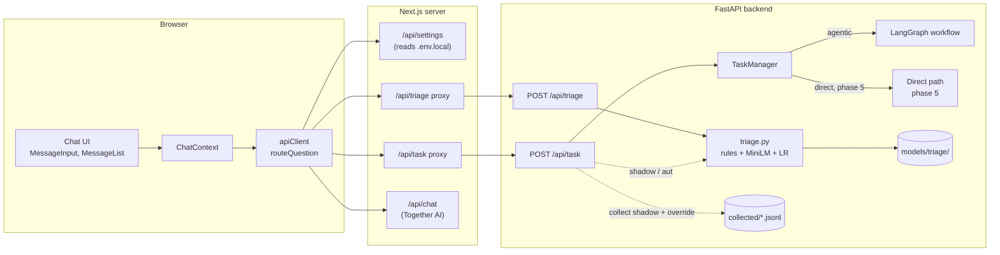
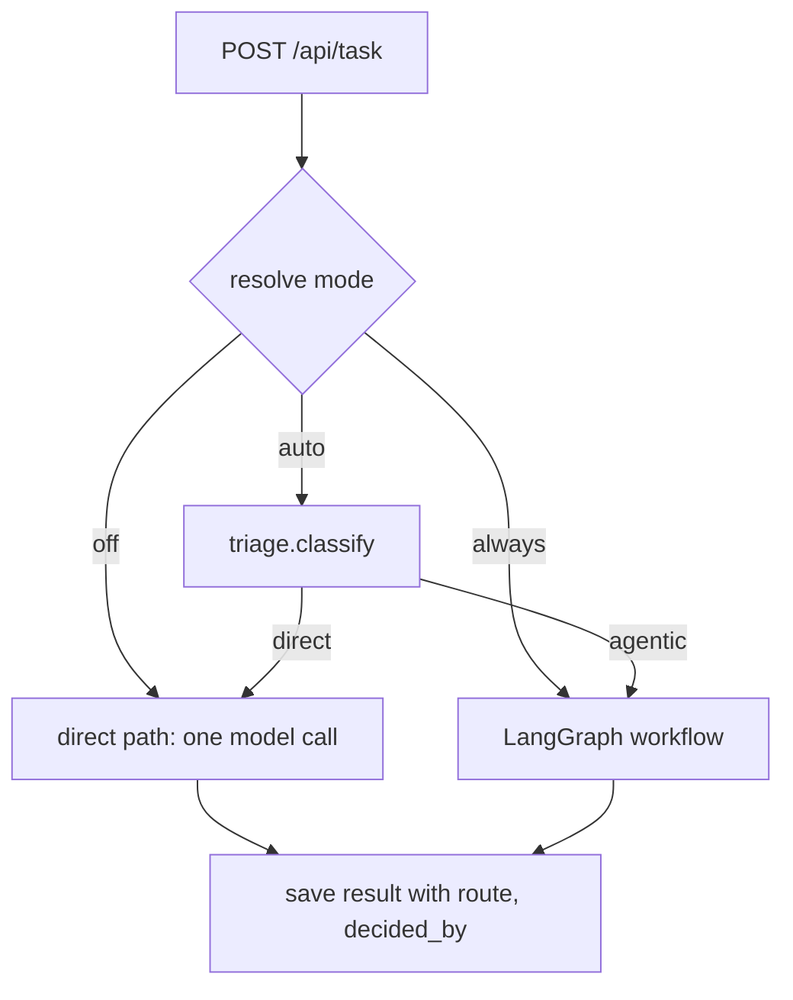

# High-level design: agentic triage

This document shows the parts of the system, how a question flows through them in each mode, what happens when something fails, and why the main choices were made. Details of each module are in the two low-level designs.

## 1. Components



| Component | Owner | Responsibility |
|---|---|---|
| `triage.py` | Backend | The only place that decides a route: rules, model, threshold, fallback, reason |
| `POST /api/triage` | Backend | HTTP wrapper around `classify`, with auth, rate limit, metrics |
| `POST /api/task` | Backend | Runs the workflow. Adds `previous_messages` (phase 0), shadow triage and collection (phase 2), override counting (phase 3), `mode` and the direct path (phase 5) |
| `/api/triage` proxy | Web server | Adds the API key; marks "backend unreachable" |
| `/api/settings` | Web server | Returns the runtime default mode |
| `apiClient.routeQuestion` | Browser | Turns mode + triage answer into a route, following the status table below |
| Chat UI | Browser | Three-way toggle, route label, override button |
| Training and eval scripts | Developer machine | Build and gate classifier versions; never run in the server |

## 2. Who decides what

- The **backend classifies**. The model, the Python ML stack, metrics and offline tests already live there, and other API clients can reuse it.
- The **web app routes**. A direct answer goes through `/api/chat`, which keeps the user's prompt style, knowledge focus and full history, and needs no polling.
- **Off** and **Always** never call triage.

## 3. Flows

### 3.1 Auto mode, routine question

```mermaid
sequenceDiagram
  participant U as User
  participant A as apiClient
  participant N as Next.js
  participant B as FastAPI
  U->>A: "explain list comprehensions"
  A->>N: POST /api/triage (2 s timeout)
  N->>B: POST /api/triage + X-API-Key
  B->>B: rules → none; model p=0.10 < threshold
  B-->>A: route=direct, decided_by=model
  A->>N: POST /api/chat (full conversation, prompt settings)
  N-->>A: answer
  A-->>U: answer + "Answered directly" + "Research this in depth"
```

### 3.2 Auto mode, research question

Same first call; the answer is `route: agentic`. The client then calls `POST /api/task` with the question and `previous_messages`, and polls `GET /api/task/{id}` as today. The answer shows "Deep research" and the workflow logs.

### 3.3 Override

The user clicks "Research this in depth" on a direct answer. The client sends that question and the messages before it to `POST /api/task` with `triage_override: true`. The backend counts the override, records the question if collection is on, and runs the workflow. The new answer is inserted directly below the direct one, under the same question; the direct one stays.

### 3.4 Shadow mode (phase 2, before the toggle exists)

The web app is unchanged: with Agentic on, it calls `/api/task`. The backend calls `classify`, records the decision (log, metric, collection, `triage` field on the result) and runs the workflow anyway.

`WEBAGENT_TRIAGE_MODE` (`shadow` or `act`) only turns this recording on or off for requests the caller sent to the workflow (`agentic: true`, later `mode: always`). It never changes a route. `POST /api/triage` always answers, and `mode: auto` in phase 5 always acts.

Shadow mode only sees questions sent with Agentic on, so its sample leans toward research questions. Routine questions reach the data later, through Auto-mode decisions and override clicks after phase 3, and through the hand-written seed set.

### 3.5 Backend modes (phase 5)



`resolve_mode` order: `mode` field, then old `agentic` / `agentic_toggle` flag, then `off`. `triage_override: true` skips all of this and routes agentic.

The direct path is text only for now: it sends the question and `previous_messages` to the model, never the image. Results of any request that carried an image set `image_ignored: true`.

## 4. Failure handling

The client acts on the triage response like this. Only Auto mode calls triage.

| Triage outcome | Route | User sees |
|---|---|---|
| 200 | `route` from the body | Normal label |
| 200 with `decided_by: fallback` (model broken) | agentic | "Deep research" |
| 200 with a body that isn't a valid triage reply | agentic | "Deep research" (`decided_by: fallback`) |
| 503 with `X-WebAgent-Proxy-Error: unreachable` | direct | Existing fallback notice (the agentic request would fail too) |
| Other 5xx, or no answer within 2 s | agentic | "Deep research" (`decided_by: fallback`) |
| 429 | none: nothing is sent | Existing rate-limit message |
| 401 | direct | Fallback notice; error logged (deployment bug) |
| Other 4xx (e.g. 422) | agentic | "Deep research" (`decided_by: fallback`); warning logged |
| Network error in the browser (fetch throws) | direct | Fallback notice |

Other failures:

| Failure | Behavior |
|---|---|
| Classifier files missing or unreadable in dev | Warning at startup (from the warm-up, which never raises); every model decision is `agentic`, `fallback`, and loading is retried at most once a minute. Rules still work |
| Classifier files or encoder missing in uat/prod, or the classifier hasn't passed the release gate | `startup_checks` fails; container doesn't start (unless `WEBAGENT_TRIAGE_ENABLED=false`) |
| Shadow triage raises | Logged; the task runs normally |
| `/api/settings` fails | Default Off |
| Always mode, image sent with no text | Direct (`decided_by: rule`): the agents would have nothing to research |
| Agentic task fails after routing | Existing fallback to `/api/chat`, unchanged |
| Collection write fails | Logged at warning; the request is not affected |

The rule behind these: when the backend is up but triage is unsure or broken, prefer research (a missed research question costs more than a slow routine one). When the backend is down, prefer direct, because research would fail anyway.

## 5. Data

| Data | Where | In git | Contains user text |
|---|---|---|---|
| Curated training and test sets | `backend/data/triage/{train,test}.jsonl` | Yes | No (reviewed and anonymized) |
| Category list | `backend/data/triage/categories.json` | Yes | No |
| Collected decisions and overrides | `backend/data/triage/collected/YYYY-MM-DD.jsonl` locally; `/app/data/triage/collected/` on the data volume in a container | No (ignored) | Yes; deleted after 30 days |
| Classifier | `backend/models/triage/classifier.joblib` (classifier + category centroids, < 100 KB) + `metadata.json` | Yes | No |
| Encoder (frozen MiniLM) | HF cache in dev; `/opt/models` in the image | No | No |
| Fine-tuned encoder (if SetFit) | `backend/models/triage/encoder/` | Git LFS / release asset | No |
| Mode setting | Browser `localStorage`, own key | n/a | No |
| Route on messages | Browser `localStorage` (chat history) | n/a | Already stored |
| Route on task results | `backend/data/results/<id>.json` | No | Already stored |

## 6. Deployment

- **Image:** the Dockerfile downloads `sentence-transformers/all-MiniLM-L6-v2` at build time into `/opt/models` and sets `SENTENCE_TRANSFORMERS_HOME=/opt/models`. It must not go under `/app/data` (`HF_HOME` today), because that path is a mounted volume and would hide baked files. The encoder loads with `local_files_only=True` in uat and prod, so startup never downloads.
- **Workers:** each uvicorn worker loads its own encoder (~90 MB of weights, ~100–150 MB resident) and uses one torch thread. The backend runs **2 workers**: Kubernetes already sets `WEB_CONCURRENCY=2`, and the Dockerfile default (used by Compose) drops from 4 to 2. The Kubernetes memory limit stays at 1 GiB; task 2.9 measures that 2 workers fit with 20% headroom.
- **The image doesn't ship the curated data.** `.dockerignore` excludes `data/*`, so `train.jsonl` and `test.jsonl` stay out of the image. `models/triage/` is copied by the existing `COPY . .`.
- **Startup:** each worker loads the model and embeds one warm-up sentence before serving. `python -m app.core.startup_checks` checks that the files exist (it doesn't load the model, to keep it fast).
- **Config:** a `triage:` section in `backend/config/{dev,uat,prod}.yaml`; `WEBAGENT_TRIAGE_*` environment variables override it, like the `security:` section.

## 7. Key decisions

| # | Decision | Why | Rejected |
|---|---|---|---|
| D1 | Local embeddings + logistic regression | ~10 ms measured (p95 9.6 ms), no cost, deterministic, testable offline, retrains in seconds | LLM prompt: 1–3 s, costs per question, not deterministic |
| D2 | Backend classifies, web app routes | One classifier for every client; direct answers keep prompt settings | Classify in the browser: duplicates logic, ships the model |
| D3 | Threshold chosen for 95% research recall (highest value up to 0.5; first estimate 0.35, `triage-2026-10-a` uses 0.5) | Missing research is worse than a slow routine answer | A threshold tuned for accuracy |
| D4 | Mode saved only on user choice, in its own key | Lets later default changes reach users who never chose | Save in the accessibility object (saved on every load) |
| D5 | Runtime default via `/api/settings` | Change the default without rebuild or restart | `NEXT_PUBLIC_` variable: build-time only |
| D6 | Shadow mode before acting | Real questions differ from hand-written ones | Ship Auto directly |
| D7 | Override button, Auto only | Fixes one misrouted answer in one click; best training label | Toggle only: three steps per correction |
| D8 | Phase 5: no mode and no flag means `off` on both endpoints | Matches "new users start on Off"; `/api/v1/chat/completions` already defaults to non-agentic; the web app always sends `agentic: true`, so it isn't affected | `always` (keeps `/api/task`'s old default, but `/api/v1/chat/completions` would change) |
| D9 | Backend direct path is text only | The backend LLM wrapper is text only; adding a vision call is separate work | `ChatTogether` with image parts now |
| D10 | 2 uvicorn workers, 1 GiB limit | Kubernetes already runs 2; keeps encoder memory at ~0.3 GB | 4 workers with a 2 GiB limit |

## 8. Known limitations

- **Shadow data leans toward research.** Shadow mode sees only questions sent with Agentic on. Routine examples come from the seed set until Auto mode and overrides produce real ones.
- **Images reach the model only through `/api/chat`.** The agentic workflow and the backend direct path ignore them (`image_ignored: true` on backend results).
- **The rules are English only.** Other languages go to the model, which was trained on English.
