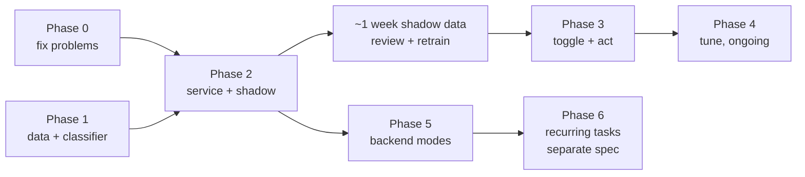

# Tasks: agentic triage

Each phase ends with all tests passing and can ship on its own. Each task lists what it covers, what it depends on, and when it is done. Estimates are in working days (d) or hours (h).

Rules for every task:

- Add or update tests in the same change. Run `npm run test`, `npm run check-types`, `npm run lint` and `python -m pytest backend/tests` before marking it done.
- Keep new files under about 200 lines; split if they grow.
- Update `CHANGELOG.md` at the end of each phase, not per task.

Phases 0 and 1 can run in parallel. Phase 5 can run before or alongside phase 3.

Total for phases 0–3 and 5: about 13 working days (8 h each), plus the shadow week. The plan's earlier figure of 8–10 days left out testing and docs time that the task list includes.

## Phase 0: fix existing problems (~1 d; tasks sum to ~7 h)

| ID | Task | Covers | Depends | Done when | Est. |
|---|---|---|---|---|---|
| 0.1 | Remove `generateMockSources` and its call in `ChatContext.tsx`. Only agentic responses set `sources` | REQ-001 | — | Jest: cite sources on + direct reply → no `sources` on the message. Existing `ChatContext` tests updated | 1 h |
| 0.2 | Add `ChatTurn` and `previous_messages` (max 8) to `TaskRequest`; put them in the workflow context. No supervisor change: `_with_history` already reads it | REQ-002 | — | pytest: 8 accepted, 9 → 422, bad role → 422; context holds the list; supervisor input contains the earlier turns. `test_followup_query.py` unchanged | 2 h |
| 0.3 | `buildPreviousMessages` in `apiClient`; send `previous_messages` from `sendMultiAgentRequest` | REQ-002 | 0.2 | Jest: request body holds the last 8 earlier messages, trimmed to 4,000 chars, current question excluded | 2 h |
| 0.4 | Image note when Agentic is on and an image is attached (becomes the Always note in phase 3) | REQ-003 | — | Jest: note shows only with an image and Agentic on | 1 h |
| 0.5 | Container run: one follow-up conversation in agentic mode; check the LangSmith trace shows the history in the supervisor prompt | REQ-002 | 0.2, 0.3 | Trace link recorded in the PR | 1 h |

## Phase 1: dataset and classifier (~3 d; tasks sum to ~23 h)

| ID | Task | Covers | Depends | Done when | Est. |
|---|---|---|---|---|---|
| 1.1 | Write the category list (ids + human labels) for both classes, including the hard-case categories | REQ-020, 021 | — | `backend/data/triage/categories.json` reviewed | 1 h |
| 1.2 | Hand-write ~150 seed questions across categories, including joined follow-ups (`previous → current`). These go into `train.jsonl` | REQ-020, 021 | 1.1 | Rows in the curated format | 3 h |
| 1.3 | Generate ~800 paraphrases with an LLM from the categories and seeds; spot-check 10% by hand; drop near-duplicates. Add to `train.jsonl` | REQ-020 | 1.2 | Generation prompt saved in `backend/data/triage/README.md`; spot-check notes | 4 h |
| 1.4 | Hand-write a separate ~150-row `test.jsonl`, stratified by category, with at least 10 rows per hard-case category. Not paraphrases of seeds; written without looking at the generated set | REQ-020, 021 | 1.1 | `eval_triage.py --check-data` passes (including the near-duplicate check against `train.jsonl`) | 3 h |
| 1.5 | `build_model_input` in `app/services/triage.py` (only this function for now) | REQ-014 | — | pytest: short follow-up joins, long one doesn't, truncation | 1 h |
| 1.6 | `backend/scripts/triage_data.py` (`load_rows`) and `backend/scripts/train_triage.py`: load, split, embed, fit, pick the highest threshold that meets recall (≤ 0.5), centroids, write `classifier.joblib` + `metadata.json` | REQ-022 | 1.5 | Smoke test with a fake encoder and 20 rows; real run < 2 min | 4 h |
| 1.7 | `backend/scripts/eval_triage.py`: metrics, per-category confusion, worst errors, exit code, `--check-data` (incl. near-duplicates), `--write-metadata` | REQ-020, 021, 023 | 1.6 | Exit code test with a fake model above and below target | 3 h |
| 1.8 | Train v1 (`triage-2026-10-a`), run the gate, commit artifacts | NFR-04 | 1.3, 1.4, 1.7 | Gate passes, or the gap is written down with a plan (more data, or SetFit early) | 2 h |
| 1.9 | Time `/api/chat` for 20 routine questions (median, p95); confirm or change the < 10 s target | NFR-02 | — | Numbers in this spec's README and the plan | 1 h |
| 1.10 | Measure classify latency (p50/p95) and resident memory of one loaded model on CPU | NFR-01, 06 | 1.8 | Numbers recorded; feed task 2.9 | 1 h |

## Phase 2: backend service and shadow mode (~4 d; tasks sum to ~30 h)

| ID | Task | Covers | Depends | Done when | Est. |
|---|---|---|---|---|---|
| 2.1 | `TriageConfig`, YAML sections in dev/uat/prod, `WEBAGENT_TRIAGE_*` overrides, `settings.TRIAGE` | REQ-016, 017, 030 | — | pytest: YAML values, each env override, bad values ignored with a warning | 3 h |
| 2.2 | `triage_model.py`: load, lock, failed-load backoff, encoder-name check, `predict_proba`, `nearest_category`, `warm_up`; `FakeTriageModel` in `tests/fakes/` | REQ-015, NFR-07 | 1.8 | pytest with fake; real-model test skipped when not cached | 4 h |
| 2.3 | `triage.py`: `TriageDecision`, `match_rule`, `classify` (rules, model, threshold, fallback, kill switch, reason, optional tie-breaker) | REQ-012–018 | 2.1, 2.2 | `test_triage_rules.py`, `test_triage_classify.py` pass | 4 h |
| 2.4 | Metrics (four series) and the decision log line; no question text outside dev | REQ-033, 080 | 2.3 | pytest reads the registry; `caplog` checks text only in dev | 2 h |
| 2.5 | `POST /api/triage` endpoint and mount in `main.py` with API key | REQ-010 | 2.3 | `test_triage_endpoint.py`: contract, 401, 422 | 2 h |
| 2.6 | Next.js `/api/triage` route; `X-WebAgent-Proxy-Error` header in `backend.ts` | REQ-011 | 2.5 | `triageProxy.test.ts` passes; existing `taskProxy` test still passes | 1 h |
| 2.7 | `triage_collect.py` (record, cleanup), startup + daily cleanup, `.gitignore` entry | REQ-030–032 | 2.1 | `test_triage_collect.py` passes | 3 h |
| 2.8 | Startup: warm-up hook; `check_triage_files` in `startup_checks` | NFR-08 | 2.2 | pytest: prod without files fails, dev passes, disabled passes | 2 h |
| 2.9 | Docker: bake the encoder into `/opt/models`, set `SENTENCE_TRANSFORMERS_HOME`, change the image default to `WEB_CONCURRENCY=2` (Kubernetes already sets 2; Compose uses the image default). Measure image size and memory of 2 workers | NFR-06, 09 | 2.8 | Container starts offline (no network) and classifies; image +≤ 100 MB; 2 workers fit the Kubernetes limit with 20% headroom (if not, stop and decide before shadow mode). Done: 1.08 GiB measured, limit raised to 1.5 GiB | 3 h |
| 2.10 | Shadow mode in `/api/task`: classify requests sent with `agentic: true` (not overrides), store `triage` on the result, collect; triage errors never fail the task | REQ-040 | 2.3, 2.4, 2.7, 0.2 | `test_task_shadow.py` passes | 3 h |
| 2.11 | Grafana panel: route split, override rate, uncertain rate | REQ-081 | 2.4 | Panel added to `backend/grafana/dashboards/webagent-backend-dashboard.json`; screenshot in the PR | 2 h |
| 2.12 | Turn on `mode: shadow` in dev, where collection is on (development is local-only for now). In uat, only if collection there is approved; without it, shadow mode records metrics but no questions. Document where collected files are (repo `backend/data/triage/collected/` when run locally; `docker cp` from `/app/data/triage/collected/` in a container) | REQ-040 | 2.10 | Config merged; backend README section | 1 h |

**Shadow week (calendar time, ~0.5 d of work):** use Agentic on for about a week, with a deliberate mix of routine and research questions, because shadow mode only sees questions sent to the workflow. Then label collected questions with an LLM judge, review every judge/classifier disagreement, anonymize, add to `train.jsonl` (never to `test.jsonl`), retrain, and re-run the gate. Exit criterion: the gate passes on the updated data.

## Phase 3: toggle, labels, act (~3.5 d; tasks sum to ~28 h)

| ID | Task | Covers | Depends | Done when | Est. |
|---|---|---|---|---|---|
| 3.1 | `src/types/routing.ts`; `route`/`imageAttached` on `ChatMessage`; `route` on `ChatCompletionResponse` | REQ-057 | — | `npm run check-types` passes | 1 h |
| 3.2 | `agenticMode.ts`: own storage key, get/save, `migrateLegacyAgenticSetting`; remove `agentic` from `AccessibilitySettings` | REQ-051, 052 | 3.1 | `agenticMode.test.ts` passes | 3 h |
| 3.3 | `GET /api/settings` with mtime-cached `.env.local` read and `process.env` fallback; `.env.local.example` entry | REQ-053 | 3.1 | `settingsRoute.test.ts` passes; manual: edit `.env.local`, reload, new default applies with no restart | 3 h |
| 3.4 | `AppContext`: `agenticMode`, `setAgenticMode`, `modeReady`, load sequence | REQ-051, 054, 055 | 3.2, 3.3 | `AppContext.mode.test.tsx` passes | 2 h |
| 3.5 | `routeQuestion.ts` with the status-code mapping, 2 s timeout and 8,000-char cut | REQ-056 | 2.6, 3.1 | `routeQuestion.test.ts` passes, one test per table row | 3 h |
| 3.6 | `apiClient.sendChatMessage(mode, {forceAgentic})`; attach `route`; `triage_override` in the task body; fallback sets the route | REQ-056, 058 | 3.5, 0.3 | `apiClient.agentic.test.ts` passes; existing agentic tests updated | 3 h |
| 3.7 | Backend: count and collect `triage_override` in `/api/task` | REQ-058 | 2.7 | pytest passes | 1 h |
| 3.8 | `ChatContext`: pass mode, store route and `imageAttached`, logs by route, `researchInDepth` | REQ-057, 058 | 3.6 | `ChatContext` tests pass | 3 h |
| 3.9 | `AgenticModeToggle.tsx` and wiring in `MessageInput` (disabled until `modeReady`; image note in Always) | REQ-003, 050, 054 | 3.4 | Component test passes; manual keyboard check | 3 h |
| 3.10 | `RouteLabel.tsx` and wiring in `MessageList` | REQ-057, 058 | 3.8 | Component test passes | 2 h |
| 3.11 | Set `WEBAGENT_TRIAGE_MODE=act` wherever shadow was turned on (stops shadow recording; routes are already chosen by the web app) | REQ-040 | Shadow week | Config merged | 0.5 h |
| 3.12 | Container run: 10 research + 10 routine questions in Auto; record route, time, trace | NFR-01–03 | 3.1–3.11 | Results table in the PR; targets met or gaps listed | 2 h |
| 3.13 | Docs: README (modes, labels, override), backend README (triage endpoint, config), `docs/TESTING.md`, CHANGELOG, version bump | — | 3.12 | Reviewed | 2 h |

## Phase 4: tune (ongoing)

| ID | Task | Covers | Cadence |
|---|---|---|---|
| 4.1 | Review collected overrides and shadow/act decisions; anonymize; add to `train.jsonl`; retrain; run the gate; ship a new version only if it improves and passes | NFR-04, 05 | Weekly |
| 4.2 | Watch the override rate (target < 10% of direct answers) and uncertain rate in Grafana | NFR-05 | Weekly |
| 4.3 | If the frozen encoder plateaus below the gate: `train_triage.py --setfit`; store the encoder with Git LFS or as a release asset; re-measure memory and latency | REQ-024 | When needed |
| 4.4 | Decide whether to turn on the LLM tie-breaker, based on the uncertain rate and override rate | REQ-017 | After 4 weeks of data |

## Phase 5: backend modes for API clients (~1.5 d; tasks sum to ~12.5 h)

| ID | Task | Covers | Depends | Done when | Est. |
|---|---|---|---|---|---|
| 5.1 | `app/services/routing.py`: `resolve_mode` (no mode + no flag → `off`), `choose_route` | REQ-070 | 2.3 | `test_task_modes.py` table passes | 2 h |
| 5.2 | Extract `SupervisorAgent.answer_directly(query, previous_messages)`; `run()` calls it (no behavior change) | REQ-071 | — | Existing supervisor tests pass | 2 h |
| 5.3 | `TaskManager.run_direct`: text only; same result shape as the workflow | REQ-071 | 5.2 | pytest: workflow factory not called; result shape matches | 2 h |
| 5.4 | `/api/task`: `mode`, `agentic: Optional[bool] = None`, dispatch to `run_direct` or `run_workflow`; `route`, `decided_by`, `p_agentic`, `image_ignored` on results; shadow condition uses the resolved mode | REQ-012, 070, 071, 072 | 5.1, 5.3 | pytest: every mode/flag combination; neither field → `off`; image in auto → direct with `image_ignored: true`; same decision as `/api/triage` | 3 h |
| 5.5 | `/api/v1/chat/completions`: `mode`, `agentic_toggle: Optional[bool] = None`, same `resolve_mode` | REQ-070 | 5.1 | pytest: neither field → `off` (unchanged for callers) | 2 h |
| 5.6 | Mark `POST /api/v1/chat/` and `POST /api/v1/tasks/create` deprecated in OpenAPI | REQ-073 | — | `deprecated: true` in `/api/v1/openapi.json` | 0.5 h |
| 5.7 | Docs: backend README API section with `mode` examples (`curl`); note that `/api/task` with neither `mode` nor `agentic` now means `off`, and that images are ignored; CHANGELOG | — | 5.4, 5.5 | Reviewed | 1 h |

## Requirement coverage

| Requirement | Tasks |
|---|---|
| REQ-001 | 0.1 |
| REQ-002 | 0.2, 0.3, 0.5 |
| REQ-003 | 0.4, 3.9 |
| REQ-010 | 2.5 |
| REQ-011 | 2.6 |
| REQ-012 | 2.3, 5.4 |
| REQ-013 | 2.3 |
| REQ-014 | 1.5, 2.3 |
| REQ-015 | 2.2, 2.3 |
| REQ-016 | 2.1, 2.3 |
| REQ-017 | 2.1, 2.3, 4.4 |
| REQ-018 | 2.3 |
| REQ-020 | 1.1–1.4, 1.7 |
| REQ-021 | 1.1, 1.2, 1.7 |
| REQ-022 | 1.6 |
| REQ-023 | 1.7, 1.8 |
| REQ-024 | 4.3 |
| REQ-030 | 2.1, 2.7 |
| REQ-031 | 2.7 |
| REQ-032 | 2.7 |
| REQ-033 | 2.4 |
| REQ-040 | 2.10, 2.12, 3.11 |
| REQ-050 | 3.9 |
| REQ-051 | 3.2, 3.4 |
| REQ-052 | 3.2 |
| REQ-053 | 3.3 |
| REQ-054 | 3.4, 3.9 |
| REQ-055 | 3.4 |
| REQ-056 | 3.5, 3.6 |
| REQ-057 | 3.1, 3.8, 3.10 |
| REQ-058 | 3.6, 3.7, 3.8, 3.10 |
| REQ-070 | 5.1, 5.4, 5.5 |
| REQ-071 | 5.2, 5.3, 5.4 |
| REQ-072 | 5.4 |
| REQ-073 | 5.6 |
| REQ-080 | 2.4 |
| REQ-081 | 2.11 |
| NFR-01 | 1.10, 3.12 |
| NFR-02 | 1.9, 3.12 |
| NFR-03 | 3.12 |
| NFR-04 | 1.8, 4.1 |
| NFR-05 | 4.1, 4.2 |
| NFR-06 | 1.10, 2.9 |
| NFR-07 | 2.2 |
| NFR-08 | 2.8 |
| NFR-09 | 2.9 |
| NFR-10 | every task |

## Decisions made while writing the specs (2026-10-11)

| # | Question | Decision | Affects |
|---|---|---|---|
| O-1 | Should the backend direct path send images to the model? | **No, text only for now.** Results set `image_ignored: true` when a request had an image | REQ-071, task 5.3 |
| O-2 | What does a request with neither `mode` nor the old flag mean? | **`off`**, on both `/api/task` and `/api/v1/chat/completions` | REQ-070, tasks 5.1, 5.4, 5.5 |
| O-3 | Memory with the encoder in every worker | **2 workers** (image default and Kubernetes); limit raised from 1 GiB to 1.5 GiB after measuring | NFR-06, task 2.9 |

No open points remain for phases 0–5. Phase 6 questions (schedule ownership, delivery, limits) belong to its own spec.
