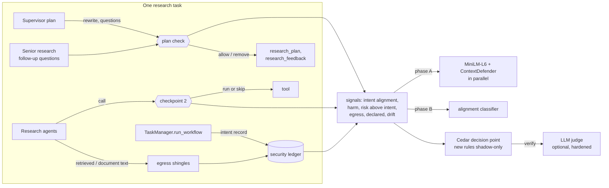
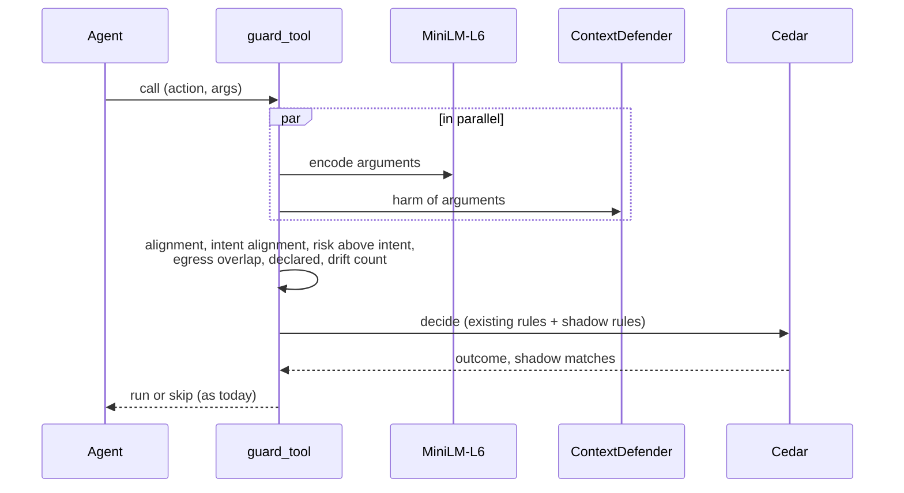

# High-level design: checkpoint 2 checked against the user's intent

Requirement IDs refer to [`requirements.md`](requirements.md); details are in the
[backend](design-low-level-backend.md) and [model and data](design-low-level-model-data.md)
designs. The existing checkpoints are described in [`../agentic-security/`](../agentic-security/README.md).

## 1. Components

| Component | Role | New? |
|---|---|---|
| `app/security/intent.py` | Intent record; plan check (`plan::rewrite`, `plan::subgoal`); declared tools | new |
| `app/security/egress.py` | Salted 8-word shingles of private text; `egress_overlap` of a search | new |
| `app/security/signals.py` | Scores a call or subgoal against the intent: phase A (encoder and ContextDefender in parallel) or phase B (classifier) | new |
| `app/security/alignment_model.py` | Loads and runs the classifier; gate check; thresholds; judge band; fallback | new (phase B) |
| `app/core/startup_checks.py` | uat/prod refuse an ungated classifier in the model folder | changed (phase B) |
| `app/security/tool_guard.py` | Adds the new signals to checkpoint 2's context | changed |
| `app/security/{ledger,judge,thresholds,decision,records}.py` | Ledger fields and merge; judge prompt; thresholds; context defaults; collection | changed |
| `config/security/{policies.cedar,schema.cedarschema,policy_tests.yaml,patterns.json}` | New actions, fields, shadow rules, test rows, code-request keywords | changed |
| `app/services/task_manager.py`, `app/agents/{supervisor,senior_research,internal_research,document_extraction_agent,coding_review}.py` | Hook points | changed |
| `scripts/{fetch_alignment_sources,build_alignment_dataset,generate_alignment_calls,train_alignment_model,eval_alignment_model,eval_alignment_suites,bench_checkpoint2}.py` and helpers (`alignment_{sources,data,pairs,agent_pairs,eval_pairs,training}.py`) | Phase B data, training, gate, evaluation; checkpoint 2 latency | new |

## 2. Who decides what

| Question | Decided by |
|---|---|
| What the user wants | The intent record: the user's own turns, fixed at task start (SEC-100) |
| Is a subgoal or call aligned, and riskier than the intent? | The signals: encoders in phase A, the classifier in phase B |
| What happens | Cedar policies; the new ones shadow-only until phase C (SEC-109, SEC-130) |
| Borderline cases | The judge, if on (SEC-111, SEC-127); otherwise `verify` keeps its current meaning |
| When a rule acts | A person, from shadow data and the gate, one rule per release (SEC-130) |

## 3. Flows

### 3.1 Task start (SEC-100)

`run_workflow` creates the ledger (as today) and adds the intent record: the user's turns, their
MiniLM-L6 embedding, and the turn's ContextDefender harm (usually a cache hit from the intake
check). Nothing else changes.

### 3.2 Plan check (SEC-101, SEC-102)

After the supervisor writes `research_plan`, the guard scores the rewrite and each plan question
against the intent and decides `plan::rewrite` and `plan::subgoal`. When the senior research agent
asks for another round, each follow-up question is decided the same way before
`research_feedback` is stored. In shadow mode the outcomes are recorded only; in act mode a
declined rewrite falls back to the user's turn and a declined question is removed.

### 3.3 A tool call (SEC-103 – SEC-108)

`guard_tool` builds its context as today, plus: intent alignment and argument harm (computed in
parallel), risk above intent, egress overlap (search only), declared, and the drift counter. Cedar
decides with the existing and the new (shadow) rules; the outcome is applied as today.

### 3.4 Private text (SEC-106)

After an allowed retrieval or document read, the agent hands the text to `egress.remember`, which
stores salted hashes of its 8-word windows (minus windows in the intent) in the ledger. A later web
search is compared against them.

### 3.5 Phase B

The classifier replaces the two encoder passes for intent alignment and risk (one pass, about
5 ms), and its uncertain band selects what the judge sees. Everything else stays.

## 4. Failure handling

| Failure | Effect | Handling |
|---|---|---|
| Base encoder unavailable | No alignment signals | Defaults (match no rule), `signals_available` false, logged once (SEC-110) |
| ContextDefender unavailable | No harm signals | Same |
| Classifier missing or not gated | — | Phase A signals, `classifier_available` false; uat/prod refuse to start with an ungated model present (SEC-126) |
| Plan check error | — | Subgoals kept unchanged (fail open, as search and retrieval at SEC-061), error logged |
| Judge timeout or error | — | `NOT_ALIGNED`, as SEC-045 |
| Shingle store grows large | Memory per task | Capped at 20,000 hashes per task (oldest dropped); egress is a shadow signal |

## 5. Data

| Item | Where | Contents | Kept |
|---|---|---|---|
| Intent record | Ledger (in memory, with the task) | Intent text, embedding, harm | The task's lifetime; not in results |
| Shingle hashes | Ledger | Salted SHA-256 of 8-word windows | The task's lifetime; never in results, logs or collection |
| Collection rows | `data/security/collected/` | New numeric fields; text only in dev | 30 days (unchanged) |
| Dataset | `data/security/alignment/` (Git LFS) | (intent, call, labels) rows | In the repository |
| Model | `models/security/alignment/` | Encoder, heads, metadata | In the repository and image |

## 6. Deployment

- **Phase A** adds no model and no service; it ships in the image as code and policies (3.7.0),
  before the shadow week, with every new rule shadow-only.
- **Phase B** adds about 90 MB (L6) or 130 MB (L12) to the image and to each worker (3.8.0).
- **Phase C** changes policies only, one rule per release.

## 7. Decisions

See the README's decisions. In short: the user's turns are the reference; a small calibrated
classifier, not an LLM, on the main path; phase A first and before the shadow week; parallel
scoring keeps the 20 ms budget; data only from approved sources.

## 8. Known limitations

- **Topic is not intent.** Until phase B, alignment is topic similarity; risky on-topic subgoals
  are caught only by the harm-based risk signal, whose scores on short queries are uncalibrated.
- **Code** is judged by the coding assistant's own `explanation` until the classifier has code
  rows (RedCode for risky code, our coding agents for benign).
- **Decomposition** (a harmful goal split into harmless steps) and slow drift have no trainable
  public data; the drift rule's threshold comes from shadow data.
- **Egress** by paraphrase (rewording private text) isn't caught by shingles.
- **The intent can be wrong too.** It protects against agents, not against a harmful user; that
  remains checkpoint 1's job.
