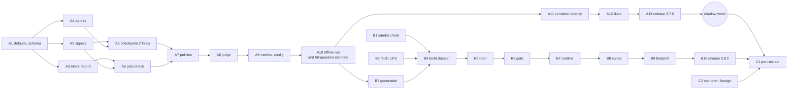

# Tasks: checkpoint 2 checked against the user's intent

Status (2026-10-16): phase A released as 3.7.0. Phase B built for 3.8.0 (B1, B2, B4–B8, B10); B3's
script has both modes (plans, and `--code` for benign code rows) but its full runs wait for the
Together credit figure (and, for code, a coding-questions file from the fetch step); no candidate passed the gate (B6), so B9
(footprint of an installed model) doesn't apply yet and the classifier is not installed. Results are
in the README's implementation notes. Phase C needs the shadow week's data.

Three phases. Each task lists what it covers, what it depends on and when it is done. Estimates are
in hours (h).

Rules for every task:

- Tests in the same change; run `python -m pytest backend/tests`, `ruff check backend`, `npm test`,
  `npm run check-types` and `npm run lint` before marking it done.
- New rules stay `@shadow("true")` until phase C (SEC-109, SEC-130).
- No intent, subgoal or private text outside dev in logs, metrics or collection (SNFR-13).
- Data: approved sources only; no hand-written adversarial text; counts only (SNFR-17).
- Work on `release/X.Y.Z`; merge through a PR with both CI checks green (SNFR-19).

## Phase A: signals and shadow rules (release 3.7.0, before the shadow week)

| ID | Task | Covers | Depends | Done when | Est. |
|---|---|---|---|---|---|
| A1 | Threshold defaults (`thresholds.py`), `CONTEXT_DEFAULTS`, Cedar schema fields and `plan::*` actions, `PlanAction` type | SEC-110 | — | Engine loads with the old policies; defaults match no rule (pytest) | 2 h |
| A2 | `signals.py`: one encode for both cosines, ContextDefender harm in parallel, defaults on failure; `alignment.encode` | SEC-103, SEC-104, SEC-105, SEC-110 | A1 | `test_security_signals.py` passes, including the parallel-timing case | 4 h |
| A3 | `intent.record_intent` and its call in `run_workflow` | SEC-100 | A1 | `test_security_intent.py` intent cases pass; the ledger's `intent` never appears in results | 2 h |
| A4 | `egress.py`; `remember` after retrieval (`internal_research.py`) and document read (`document_extraction_agent.py`) | SEC-106, SNFR-13 | A1 | `test_security_egress.py` passes (overlap, exclusions, cap, nothing persisted) | 3 h |
| A5 | `tool_guard._build_context`: new fields per action, `scored_text` (coding review passes the `explanation`), `declared` with `config/security/intent.json`, drift counter | SEC-103, SEC-104, SEC-107, SEC-108 | A2, A4 | Extended `test_security_tool_guard.py` passes; `scored_text` never reaches a tool | 4 h |
| A6 | `intent.check_plan` (supervisor) and `check_follow_ups` (senior research, both places); act-mode removal and fallback; counting; fail open | SEC-101, SEC-102 | A2, A3 | Plan-check cases pass in shadow and act | 5 h |
| A7 | Nine shadow rules; delete `untainted-search-misaligned`; `policy_tests.yaml` rows; SEC-044a marked superseded in the agentic-security spec | SEC-109 | A5, A6 | Policy table passes at load; every new rule shadow-only (pytest) | 3 h |
| A8 | Judge prompt with markers, intent, subgoals, recent calls | SEC-111 | A7 | `test_security_judge_prompt.py` passes | 2 h |
| A9 | Metrics; collection fields; `plan_check` and `alignment_model_dir` config with `WEBAGENT_GUARD_PLAN_CHECK`; ledger merge | SEC-112, SEC-113, SEC-114, SEC-115 | A8 | Extended records, config, metrics and merge tests pass | 3 h |
| A10 | Offline run: InjecAgent (`--untainted`) and a benign sample through the new signals; set the starting thresholds from it; record results. The benign sample is the 50-question generation estimate (B3's first step, with its generation script's `--estimate` mode, run here) | SEC-131 (partial), SEC-109, SEC-122 (estimate) | A9 | Numbers, the estimate's cost and the chosen starting values in the PR; `thresholds.py` updated | 4 h |
| A11 | Container latency, idle and with both workers busy | SNFR-10 | A10 | p95 per call < 20 ms (or < 30 ms with the reason recorded) in the PR | 2 h |
| A12 | Docs: RUNBOOK, shadow-week runbook (new metrics and what to look for), backend README (setting), `.env.local.example`, agentic-security README pointer, CHANGELOG with upgrade notes | — | A11 | Reviewed in the PR | 3 h |
| A13 | Release 3.7.0: version bump, PR, both CI checks green, merge, tag, fast-forward `dev` | SNFR-19 | A12 | `v3.7.0` tagged; then the shadow week starts | 1 h |

Phase A: about 38 h.

## Phase B: the classifier (release 3.8.0)

| ID | Task | Covers | Depends | Done when | Est. |
|---|---|---|---|---|---|
| B1 | saroku quality check: read its technical report; label balance; agreement on a stratified sample (counts only); the label mapping | SEC-121 | — | `QUALITY.md` says passed (with the mapping) or failed (saroku excluded) | 3 h |
| B2 | `fetch_alignment_sources.py`; `.gitattributes` patterns; `local/` git-ignored; user's Hugging Face token found (needs `hf auth login`) | SEC-120, SEC-121 | — | Every approved source fetched or reported missing; nothing gated in a tracked path | 3 h |
| B3 | `generate_alignment_calls.py` full run within the credit rule (the script and its 50-question estimate come from A10) | SEC-122 | A10 | Rows written; credit floor respected | 3 h + run |
| B4 | `build_alignment_dataset.py`, `--check-data`, data README and `counts.json` | SEC-120, SEC-121, SNFR-17 | B1, B2, B3 | `--check-data` passes; README lists every source, licence, role and count | 8 h |
| B5 | `train_alignment_model.py`: L6 and L12 cross-encoders and the siamese baseline; calibration; thresholds and band | SEC-123, SEC-124 | B4 | Three candidates with metadata | 6 h |
| B6 | `eval_alignment_model.py`: gate on test, probe report, latency | SEC-125, SNFR-11 | B5 | The shipping model's `metadata.json["test"]["passed"]` is true | 3 h |
| B7 | `alignment_model.py`; `signals` uses it; startup check; judge band | SEC-126, SEC-127 | B6 | `test_alignment_model.py` passes; fallback works without the model | 5 h |
| B8 | `eval_alignment_suites.py` and InjecAgent `--untainted` with the model | SEC-131 | B7 | Counts per suite in the PR | 3 h |
| B9 | Footprint: image size, memory with two workers, latency in the container | SNFR-11, SNFR-12 | B8 | Within limits, in the PR | 2 h |
| B10 | Docs (data README, RUNBOOK, CHANGELOG) and release 3.8.0 | SNFR-19 | B9 | `v3.8.0` tagged | 3 h |
| B11 | Shadow-only classifier: `--install-shadow`, scores recorded and observed, never deciding; rebuilt data (Researchy Questions, xLAM, TraceSafe, code calls) and the retrained L6 installed shadow-only; release 3.9.0 | SEC-128 | B10 | `test_alignment_model.py` shadow tests pass; `v3.9.0` tagged | 6 h |

Phase B: about 40 h, plus the generation run.

## Phase C: rules that act (one release per rule)

| ID | Task | Covers | Depends | Done when | Est. |
|---|---|---|---|---|---|
| C2 | Red-team suite: plan-check and egress cases from approved data; benign suite re-run | SEC-131, SNFR-03, SNFR-04 | A13 | Both suites pass with the rule set to act in a test configuration | 4 h |
| C1 | For each rule, in order (`private-egress-decline`, `call-risk-above-intent-decline`, `off-intent-search-verify`, `subgoal-harm-decline`, then the rest): threshold from shadow data or the gate, shadow false-positive rate on reviewed tasks within target, remove `@shadow`, release | SEC-130 | Shadow week, B10 (for model-based thresholds), C2 | The rule acts with `tool_mode: act`; its measurement in the PR | 2 h per rule |

## Requirement coverage

| Requirement | Tasks |
|---|---|
| SEC-100 | A3 |
| SEC-101, SEC-102 | A6 |
| SEC-103, SEC-104 | A2, A5 |
| SEC-105 | A2 |
| SEC-106 | A4 |
| SEC-107, SEC-108 | A5 |
| SEC-109 | A7, A10 |
| SEC-110 | A1, A2 |
| SEC-111 | A8 |
| SEC-112 – SEC-115 | A9 |
| SEC-120 | B2, B4 |
| SEC-121 | B1, B2, B4 |
| SEC-122 | A10 (estimate), B3 |
| SEC-123, SEC-124 | B5 |
| SEC-125 | B6 |
| SEC-126, SEC-127 | B7 |
| SEC-128 | B11 |
| SEC-130 | C1 |
| SEC-131 | A10, B8, C2 |
| SNFR-10 | A11 |
| SNFR-11 | B6, B9 |
| SNFR-12 | B9 |
| SNFR-13 | A4, every task |
| SNFR-14 – SNFR-16, SNFR-18 | every task (review, CI) |
| SNFR-17 | B4, every data task |
| SNFR-19 | A13, B10, C1 |

## Plan sections and where they went

| Plan section | Here |
|---|---|
| 7.1 Intent record | SEC-100 |
| 7.2 Plan check | SEC-101, SEC-102 |
| 7.3 Per-call signals | SEC-103 – SEC-108, SEC-110 |
| 7.4 Policies | SEC-109, SEC-130 |
| 7.5 Classifier | SEC-123 – SEC-128 |
| 7.6 Judge | SEC-111, SEC-127 |
| 7.7 Metrics, records, configuration | SEC-112 – SEC-115 |
| 8 Data, 8.1, 8.2 | SEC-120 – SEC-122, model-and-data design §2 |
| 9 Evaluation and gate | SEC-125, SEC-131 |
| 10 Phases | Phases A–C above |
| D5 (latency) | SEC-105, SNFR-10 |
