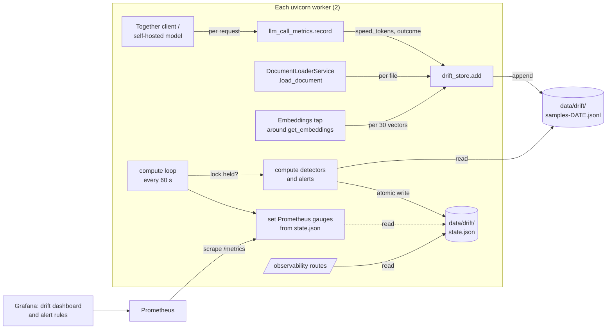
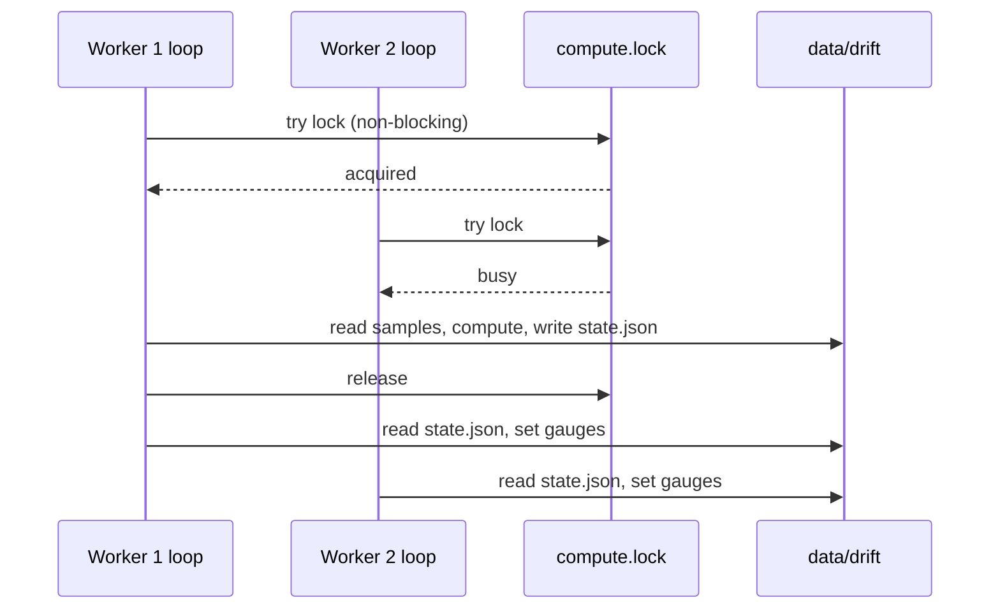

# High-level design: real drift and alerts

Requirement IDs refer to [`requirements.md`](requirements.md); module and file details are in the
[backend](design-low-level-backend.md) and [ops](design-low-level-ops.md) designs.

## 1. Components

| Component | Role | New? |
|---|---|---|
| `app/core/drift_store.py` | Append samples; freeze references; compute detectors and alerts under a lock; read and write `state.json`; retention | new |
| `app/core/drift_detection.py` | Pure scoring functions (KS, chi-square, centroid); the detector classes and registry go | changed |
| `app/core/drift_reference.py` | Detector table; per-detector reference freeze, current window and scoring; the public fields | new |
| `app/core/drift_alerts.py` | Figures (requests, errors, rate limits, tokens, loads) from the samples; alert rules over the figures and detector results | new |
| `app/services/llm_call_metrics.py` | Also adds drift samples per request, with the call label | changed |
| `app/services/together_llm.py`, `llm.py` | `call_label` on the clients; Together base URL from `TOGETHER_API_BASE` | changed |
| `app/services/document_loader.py` | Records document samples per loaded file (and the document-time histogram) | changed |
| `app/services/drift_embeddings.py` | Wraps the embeddings object to record centroid aggregates | new |
| `app/api/routes/observability.py` | Reads the drift state; alerts and health from it; resets write the store | changed |
| `app/core/observability.py` | New gauges and counter; `data_drift_score` in multiprocess mode `max` | changed |
| `app/core/config.py`, `main.py` | Drift settings; start and stop the compute loop | changed |
| `backend/requirements.txt` | Declares `scipy` (already installed, now explicit) | changed |
| `app/services/llm_service.py`, `document_ingestion_service.py` | Simulations removed; thin status and reset facades over the store | changed |
| `backend/grafana/…` | Drift dashboard alerts row and gauges; alert rules | changed / new |
| `backend/kubernetes/deploy.sh`, `monitoring/grafana.yaml` | Dashboards and alert rules from `backend/grafana/` | changed |
| `scripts/fake_together.py` | Dev-only fake Together completions server for the local check | new |

## 2. Who decides what

| Question | Decided by |
|---|---|
| Is this a drift? | The detector's statistical test on reference vs. current samples (OBS-007) |
| Is an alert active? | The alert rules in OBS-012, evaluated each tick by the worker holding the lock |
| What a person does about it | The runbook: look for a provider, model or prompt change; reset the baseline once understood. Nothing acts automatically |

## 3. Flows

### 3.1 A model call (OBS-001, OBS-014)

1. An agent builds its model with `get_agent_llm(agent)`; the client carries `call_label=agent`
   (`judge` and `triage` for the trusted callers).
2. The Together client sends the request and times it. On a reply or an error,
   `llm_call_metrics.record(...)` updates the Prometheus counters (as in 3.5.3) and calls
   `drift_store.add` for speed, tokens and outcome.
3. `add` appends small lines to today's samples file; it never raises and never blocks on a lock.

### 3.2 A document load (OBS-002)

`load_document` times the load; after it finishes (or fails) it adds processing time, size,
type and outcome. Directory loads call it per file, so each file counts once.

### 3.3 Embeddings (OBS-003)

The wrapper passes calls through to the real embeddings object and adds each returned vector to a
per-worker running sum. At 30 vectors it appends one aggregate and resets the sum. A process that
stops before 30 loses that partial sum, which is acceptable.

### 3.4 A compute tick (OBS-005–OBS-012)

1. Every `WEBAGENT_DRIFT_INTERVAL_SECONDS` (60) each worker's loop tries a non-blocking lock on
   `data/drift/compute.lock`.
2. The worker that gets it reads the state and the retained sample files, freezes any reference that just reached `WEBAGENT_DRIFT_WINDOW` (50) samples, scores each
   detector with enough data (a frozen reference and at least 30 current samples), evaluates the
   alerts, logs transitions, runs the sample cleanup if a day has passed, and writes `state.json`
   atomically (write to a temp file, then rename).
3. Every worker (with or without the lock) reads `state.json` and sets its gauges.

### 3.5 A reset (OBS-009)

`POST /observability/llm/reset_baseline` (or `doc`) writes the group's reset time into
`state.json` under the lock (waiting for it, unlike the loop) and clears that group's frozen
references. From then on, each detector's first 50 samples form its new reference, and it scores
again once 30 more have arrived.

### 3.6 An alert (OBS-012, OBS-015–OBS-017)

The tick that first finds an alert's condition true records it with `since` in `state.json` and
logs it once. Every worker sets `webagent_alert_active{alert,severity}=1`. Prometheus scrapes it;
the dashboard's alert row shows it; the Grafana rule on that series fires and appears in
Grafana's alert list. The first tick the condition is false clears it everywhere.

## 4. Failure handling

| Failure | Effect | Handling |
|---|---|---|
| Can't write a sample (disk full, permissions) | That sample is lost | `add` logs at DEBUG and returns; the model call or upload is unaffected |
| The computing worker dies holding the lock | `flock` is released with the process | The next tick another worker takes it |
| `state.json` unreadable or half-written | — | Written by temp-and-rename; a reader that fails keeps its last good state and logs once until a read succeeds again |
| A bad line in a samples file | — | Skipped while reading |
| Not enough data | No score, no drift, no alert | Shown as `enough_data: false` and in the dashboard's detector table |
| `WEBAGENT_DRIFT_ENABLED=false` | No samples, no loop | Routes answer with no detectors, no alerts and `healthy`, ignoring any older `state.json` |
| Network filesystem without `flock` | Both workers may compute | Same result, duplicated log lines; documented as a limit |

## 5. Data

| File | Contents | Written by | Kept |
|---|---|---|---|
| `data/drift/samples-YYYY-MM-DD.jsonl` | One line per sample: time, detector, value (number or short string), or an embedding aggregate (sum vector, count ≥ 30, dimension; the provider is in the detector name) | every worker (append) | `WEBAGENT_RESULTS_RETENTION_DAYS` (30) |
| `data/drift/state.json` | Reset times per group; frozen references; last results per detector; active alerts with `since`; figures for `/health` and `/metrics`; time of the last sample cleanup; `computed_at` | the worker holding the lock (and a reset) | until replaced |
| `data/drift/compute.lock` | Empty lock file: one computing worker per tick; resets wait for it | the loop, resets | always |
| `data/drift/append.lock` | Empty lock file: serialises appends of embedding aggregates (large lines) | embedding tap | always |

No question text, history, document text, file names or single vectors (OBS-004).

## 6. Deployment

- **Compose and the local stack:** no new service. The Grafana container gets the alert-rule
  provisioning folder (already mounted through `./grafana/provisioning`); the backend container
  gets `TOGETHER_API_BASE` and the drift settings passed through (empty means the default).
- **Kubernetes:** on every deploy, `deploy.sh` re-applies the Grafana data source, applies the
  dashboard and alert-rule ConfigMaps, and restarts Grafana; `grafana.yaml` mounts the alerting
  ConfigMap. `/app/data` is already a persistent volume (3.2.6), so
  the drift store survives restarts and redeploys.
- **Settings:** `WEBAGENT_DRIFT_ENABLED` (true), `WEBAGENT_DRIFT_WINDOW` (50),
  `WEBAGENT_DRIFT_INTERVAL_SECONDS` (60), `WEBAGENT_TOKEN_ALERT_DAILY` (0), and `TOGETHER_API_BASE`
  (now honoured).

## 7. Key decisions

See the README's decisions 1–9. In short: one shared file store, computed by one worker per tick;
references frozen; alerts as Prometheus metrics, shown on the dashboard and as Grafana rules;
failures and rate limits as alerts, not a detector; no simulations left.

## 8. Known limitations

- **Low traffic.** After a reset each detector needs a 50-sample reference and 30 current samples
  (80) before it scores. A research run makes about 8 model calls spread over several agents, so
  per-agent model drift needs roughly 30–80 research runs, depending on the agent; document drift
  needs 80 loads. The detector table shows this rather than a misleading score.
- **What drift shows.** Speed and token drift catch provider changes, overload and prompt changes;
  not answer quality.
- **Embedding threshold.** The detector's similarity threshold (0.3) is the existing one and is
  loose. In the local check (2026-10-16) the centroids of short text notes and of large CSV tables
  still had cosine similarity above 0.99 with OpenAI embeddings, so this detector will rarely fire;
  it may need tuning once real centroids exist.
- **Speed is sensitive.** With steady latencies, a KS test at p < 0.05 on 30–50 samples flags a
  shift of about 10% (seen in the local check), and a slow hour at Together can do the same.
  `model_drift` may therefore fire often on real traffic; the shadow week will show how often.
- **One replica.** The store relies on one shared data volume, as results do (improvement plan,
  decision 5). `flock` works on local and block volumes, not on every network filesystem.
- **OpenAI calls** (coding agents with an OpenAI key) are not measured.
- **Notifications** need a Grafana contact point; none is configured.
