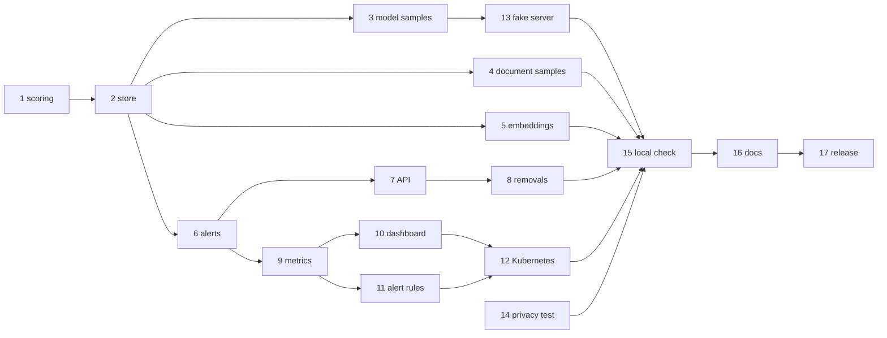

# Tasks: real drift and alerts (3.6.0)

One release. Each task lists what it covers, what it depends on, and when it is done. Estimates
are in hours (h); a working day is 8 h.

Rules for every task:

- Add or update tests in the same change. Run `python -m pytest backend/tests`, `ruff check
  backend`, `npm test`, `npm run check-types` and `npm run lint` before marking it done.
- New files stay under about 200 lines (OBS-NFR-05).
- Every new setting goes into `.env.local.example` with its default (OBS-NFR-04).
- Record only numbers and file types; never text, file names or single vectors (OBS-004).
- Work on `release/3.6.0`; merge only through the PR with both CI checks green (OBS-NFR-07).

## Tasks

| ID | Task | Covers | Depends | Done when | Est. |
|---|---|---|---|---|---|
| 1 | `drift_detection.py`: `ks_score`, `chi2_score`, `centroid_score` as pure functions; constants for the drift rules; declare `scipy` in `backend/requirements.txt` | OBS-007, OBS-NFR-02 | — | `test_drift_scoring.py` passes (same vs. shifted, seeded) | 3 h |
| 2 | `drift_store.py`: `add`, `add_aggregate`, `reset`, `compute_once`, `load_state`, `compute_loop`, `apply_gauges` (stub until task 9), `cleanup`; detector table; locks; `state.json` by temp-and-rename; settings in `config.py` and `.env.local.example` | OBS-005, OBS-006, OBS-008, OBS-009, OBS-010, OBS-011 | 1 | `test_drift_store.py` passes: 49 reference samples; frozen reference with 29/30 current; reference freeze across retention, reset, two instances, restart, two loops (one write, one log per transition), retention, bad lines | 6 h |
| 3 | `call_label` through `_build_llm`, `_build_llm_for_agent`, `get_trusted_llm` (judge, triage), `TogetherWithUsage`, `SelfHostedChatModel`; `TogetherServerError` / `TogetherRequestError` with `.status`; `llm_call_metrics.record` adds speed, tokens, outcome; Together base URL from `TOGETHER_API_BASE` | OBS-001, OBS-014, OBS-021 | 2 | `test_drift_feeding.py` model cases (200, 429, 500; agent, judge, triage, other labels), base-URL case and timing case pass; existing Together and retry tests unchanged and passing | 3 h |
| 4 | `load_document` records time, size, type, outcome (refused files record nothing) | OBS-002 | 2 | `test_drift_feeding.py` document cases pass through the upload API and `load_directory` | 2 h |
| 5 | `drift_embeddings.py` wrapper; `get_embeddings()` returns it; dimension change resets the reference; timing check | OBS-003, OBS-014 | 2 | Embedding cases and timing pass (p95 < 5 ms); if not, the wrapper is not applied and OBS-003 is recorded as dropped | 3 h |
| 6 | `drift_alerts.py`: the six rules, messages, `since`; `compute_once` calls it and stores `figures` | OBS-012 | 2 | `test_drift_alerts.py` passes: each alert fires, stays, clears; no "retrain" | 3 h |
| 7 | Observability routes read the store: `/drift`, `/alerts`, `/health`, `/metrics`; resets call `drift_store.reset`; `LLMService` and `DocumentProcessingObservability` become facades; empty answers when drift is disabled | OBS-009, OBS-013, OBS-NFR-03 | 6 | Extended `test_observability_api.py` passes: every old field present, new fields correct, API key required, disabled case | 3 h |
| 8 | Remove the simulations, detector classes and registry, `record_data_drift("llm_response", 0.8)` and `_build_llm_without_tags`; move `self_hosted_llm_service.py` to `app/services/examples/` and fix the example's import | OBS-019 | 7 | `test_drift_cleanup.py` passes; import scan and full suite pass | 2 h |
| 9 | Gauges (`webagent_alert_active`, `webagent_drift_detected`, `webagent_drift_enough_data`, `webagent_drift_current_samples`, `data_drift_score`, all `multiprocess_mode="max"`) and the samples counter; `apply_gauges`; sample cleanup at startup and the compute loop started and stopped in `main.py` | OBS-015 | 6 | Extended `test_metrics_multiprocess.py` passes: one series per label with two workers | 2 h |
| 10 | Drift dashboard: alerts row, detector table, retitled drift panels, gauge thresholds and descriptions, failure-share gauge | OBS-016 | 9 | Extended `test_grafana_dashboards.py` passes (exported metrics, uid, thresholds) | 3 h |
| 11 | `provisioning/alerting/webagent-alerts.yaml`: six rules | OBS-017 | 9 | YAML test: one rule per alert, valid queries, folder "WebAgent" | 2 h |
| 12 | `deploy.sh`: re-apply the data source, apply the dashboards and alerting ConfigMaps, restart Grafana, on every deploy; `grafana.yaml` mounts alerting and drops the inline dashboard | OBS-018 | 10, 11 | `test_deploy_script.py` passes with a fake `kubectl` (data source applied, every file in both ConfigMaps, Grafana restarted) | 2 h |
| 13 | `scripts/fake_together.py` | OBS-020 | 3 | Answers like Together; delay, error and 429 rates work (checked by hand with `curl`) | 1 h |
| 14 | Privacy test | OBS-004 | 3, 4, 5 | `test_drift_privacy.py` passes | 1 h |
| 15 | Local stack check: real calls and an upload move the samples; with the fake server and a reset, `model_drift`, `model_errors`, `rate_limited` and `document_drift` fire and clear, visible in `/observability/alerts`, on the dashboard and in Grafana's alert list | OBS-020 | 3–14 | Notes and commands in the PR; any bug found is fixed with a test first | 3 h |
| 16 | Docs (ops design §5) | OBS-NFR-04, OBS-NFR-06 | 15 | Reviewed in the PR | 3 h |
| 17 | Release (ops design §6): version 3.6.0, PR, CI green, merge, tag, fast-forward `dev` | OBS-NFR-01, OBS-NFR-07 | 16 | `v3.6.0` tagged on the merge commit; CI green on `main` | 1 h |

Total about 43 h (5.5 days).

## Requirement coverage

| Requirement | Tasks |
|---|---|
| OBS-001 | 3 |
| OBS-002 | 4 |
| OBS-003 | 5 |
| OBS-004 | 14 |
| OBS-005 | 2 |
| OBS-006 | 2 |
| OBS-007 | 1 |
| OBS-008 | 2 |
| OBS-009 | 2, 7 |
| OBS-010 | 2 |
| OBS-011 | 2 |
| OBS-012 | 6 |
| OBS-013 | 7 |
| OBS-014 | 3, 5 |
| OBS-015 | 9 |
| OBS-016 | 10 |
| OBS-017 | 11 |
| OBS-018 | 12 |
| OBS-019 | 8 |
| OBS-020 | 13, 15 |
| OBS-021 | 3 |
| OBS-NFR-01 | every task; 17 |
| OBS-NFR-02 | 1; every task (review) |
| OBS-NFR-03 | 7 |
| OBS-NFR-04 | 2, 16 |
| OBS-NFR-05 | every task (review) |
| OBS-NFR-06 | 16 |
| OBS-NFR-07 | 17 |

## Plan sections and where they went

| Plan section | Requirements |
|---|---|
| 5.1 What is measured | OBS-001, OBS-002, OBS-003, OBS-004, OBS-021 |
| 5.2 The drift store | OBS-005 – OBS-011 |
| 5.3 Alerts and health | OBS-012, OBS-013 |
| 5.4 Removing the simulations | OBS-019 |
| 5.5 Drift alerts on a dashboard | OBS-015, OBS-016, OBS-017 |
| 5.6 Kubernetes | OBS-018 |
| 6 Requirements, 7 Tasks | The plan now points here; the IDs and tasks in this spec are the only numbering |
| 9 Risks (Together credit; the local check) | OBS-020 |
