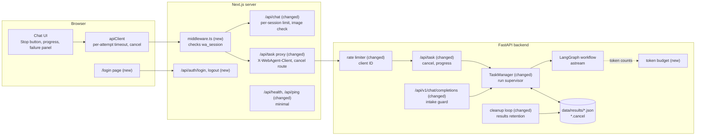
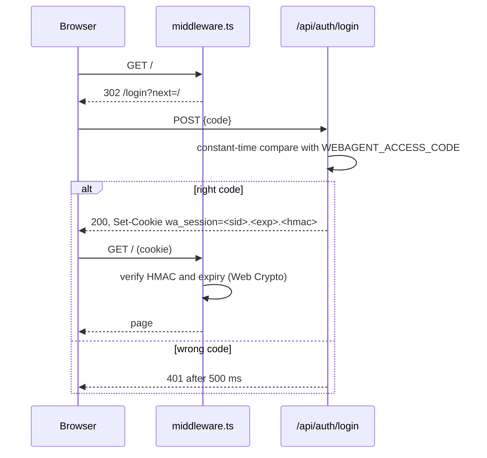
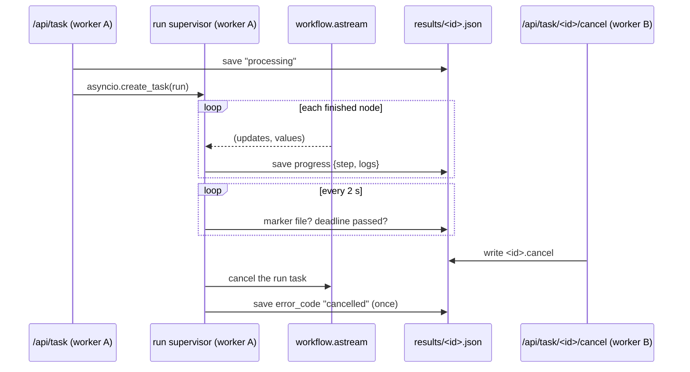

# High-level design: platform improvements

This document shows the parts that change, how requests and runs flow through them,
what happens when something fails, and why the main choices were made. Module details
are in the three low-level designs.

## 1. Components

New or changed parts are marked **(new)** or **(changed)**.

Unchanged: triage, the security guard, the agents' logic (apart from IMP-030 and
IMP-031), the direct path, and the Together `/api/chat` call itself.

**3.5.0 (IMP-128):** the web app is unchanged. Operators and integrations gain
`/api/v1/observability/*` on the backend (API key), alongside the existing Prometheus
`/metrics` scrape path and LangSmith tracing. Drift and LLM-management JSON live there; chat
still goes through `llm.py` only.

## 2. Who decides what

| Question | Decided by | Where |
|---|---|---|
| May this browser use the web app? | The web app middleware, from the signed cookie | `src/middleware.ts` |
| How fast may this caller go? | Web app: `/api/chat` limiter per session. Backend: rate limiter per client ID | `src/utils/rateLimiter.ts`; `app/core/security.py` |
| How long may a run take, and how many tokens may it use? | The run supervisor in the task manager, and the token budget | `app/services/run_supervisor.py`, `app/services/task_budget.py` |
| Has the user asked to stop? | The marker file, read by whichever worker runs the task | `app/services/result_store.py` |
| How long is a finished task kept? | The cleanup loop, from `WEBAGENT_RESULTS_RETENTION_DAYS` | `app/services/result_store.py` |
| Drift baselines and LLM observability JSON (3.5.0) | Authenticated callers via `/api/v1/observability/*` | `app/api/routes/observability.py` |
| Production request metrics (always) | Prometheus scrapes `/metrics`; not exposed on the public Ingress | `app/core/observability.py`, `main.py` |

## 3. Flows

### 3.1 Sign-in (IMP-010)

The middleware runs on every page and API request (except the paths in IMP-010). On a
valid cookie it adds the request header `x-webagent-session: <sid>` for the route
handlers, after deleting any value the browser sent.

### 3.2 A research request and its rate limits (IMP-011, IMP-012)

1. The browser sends `POST /api/task` with its cookie.
2. The middleware verifies the cookie and sets `x-webagent-session`.
3. The proxy (`backend.ts`) builds new headers: the server's `X-API-Key` and
   `X-WebAgent-Client: s:<sid>`. It copies nothing else from the browser's headers.
4. The backend's rate limiter trusts the request, because it comes from a trusted proxy
   address (a self-hosted web app) or carries a valid API key (the web app on Vercel,
   whose addresses change). So it uses `X-WebAgent-Client` as the client ID, and each
   session gets the full limit.
5. A direct caller of the backend without a valid API key is limited by its own
   address, whatever headers it sends.

`/api/chat` (direct answers) never reaches the backend; its own limiter keys on the same
session ID.

### 3.3 A run from start to finish (IMP-041, IMP-042, IMP-050, IMP-052)

- **Deadline.** `WEBAGENT_TASK_MAX_SECONDS` after the start, the supervisor cancels the
  run and saves `error_code: "timeout"`.
- **Budget.** Every Together call adds its tokens to the run's counter. The next call
  after the budget is reached raises `TaskBudgetExceeded`; the run ends with
  `error_code: "budget"`.
- **Final write wins once.** The supervisor writes the final record with a check: if
  the file already holds `cancelled`, `timeout` or `budget`, a late success from the
  stopped run isn't saved.

### 3.4 What the user sees (IMP-051, IMP-053, IMP-054)

| State | Chat shows |
|---|---|
| Processing | "Thinking…" with the current step, the latest log line, elapsed time, and **Stop** |
| Stopped by the user | "Research stopped." |
| Timeout | "The research took too long and was stopped." with **Try again** and **Answer directly instead** |
| Budget reached | "The research used its token budget and was stopped." with the same two buttons |
| Backend unreachable | "The research service isn't reachable right now." with the same two buttons |
| Other failure | "Deep research failed: <short reason>." with the same two buttons |
| Guard refusal | Unchanged (consent dialog or refusal message) |

The silent fallback to plain chat is removed: **Answer directly instead** is the user's
choice.

### 3.5 Retention (IMP-071)

At startup and every 24 hours, the cleanup loop deletes result files and markers older
than the retention period. It runs in every worker; deleting a file that another worker
just deleted is not an error.

## 4. Failure handling

| Failure | What happens | Who sees it |
|---|---|---|
| No access code in production | Every API route answers 503 `access_code_not_configured`; the login page explains | Operator, at once |
| Session secret or access code too short | Treated as not configured: API routes and sign-in answer 503 `access_code_not_configured`, with a log line naming the variable | Operator |
| Cookie tampered or expired | 401 for API calls; redirect to `/login` for pages | User |
| Together call slower than 120 s | `asyncio.TimeoutError` → the existing transient-error retry, then the agent's error path | Workflow logs |
| Tavily slower than 30 s | 3.2.7: logged, treated as no results. From 3.3.0: recorded in `search_errors`; the agent goes on with what it has | Report, logs |
| One research agent raises | The other's report is kept; the error is logged and listed in `research_errors` | Logs |
| Run passes its deadline | Cancelled; `timeout` | User (section 3.4) |
| Token budget reached | Next call raises; `budget` | User |
| Cancel requested on the other worker | Marker file; the running worker stops within 5 s | User |
| Worker dies mid-run | Unchanged: the stale "processing" record turns into "interrupted" after `WEBAGENT_TASK_TIMEOUT_MINUTES` | User |
| Thread work can't be cancelled (a Tavily call or vector search already running in a thread) | The run's task is cancelled at once and its result saved; the thread finishes in the background and its result is ignored | Nobody; a known limitation |
| Progress write fails (disk) | Logged once per run; the run continues | Logs |
| Cleanup can't delete a file | Logged; retried the next day | Logs |

## 5. Data

| Item | Where | Kept | New fields |
|---|---|---|---|
| Result file | `data/results/<id>.json` | `WEBAGENT_RESULTS_RETENTION_DAYS` (30) | `progress {step, logs, updated_at}` while processing; `error_code` (`timeout`, `budget`, `cancelled`); `tokens_used` |
| Cancel marker | `data/results/<id>.cancel` | Deleted with its result file | — (empty file) |
| Session cookie | Browser | 30 days | `<sid>.<expiry>.<hmac>` |
| Logs | `logs/webagent-<env>.log` | Unchanged rotation | No question text outside dev |

No new database, queue or cache (IMP-NFR-02).

## 6. Deployment

| Setting | Where | Default | Release |
|---|---|---|---|
| `WEBAGENT_ACCESS_CODE`, `WEBAGENT_SESSION_SECRET` | Web app (Vercel or `.env.local`) | none (production fails closed) | 3.2.7 |
| `WEBAGENT_ACCESS_CODE_DISABLED` | Web app | `false` | 3.2.7 |
| `WEBAGENT_ALLOW_OPEN_DEV` | Backend | `false` | 3.2.7 |
| `WEBAGENT_TASK_MAX_SECONDS` | Backend | 420 (under the web app's 8-minute wait) | 3.2.7 |
| `WEBAGENT_SEARCH_TIMEOUT_SECONDS` | Backend | 30 | 3.2.7 |
| `WEBAGENT_TASK_TOKEN_BUDGET` | Backend | 0 (off) until task 2.10 sets it from measurement (IMP-042) | 3.3.0 |
| `WEBAGENT_RESULTS_RETENTION_DAYS` | Backend | 30 | 3.3.0 |
| `WEBAGENT_IMAGE_HOSTS` | Web app | empty | 3.3.0 |
| `WEBAGENT_LDA_MAX_CHARS` | Backend | 200000 | 3.4.0 |
| `WEBAGENT_EMBEDDINGS_PROVIDER` | Backend | `openai` | 3.4.0 |

Kubernetes keeps one replica (decision 5). 3.3.0 adds a NetworkPolicy and an Ingress rule
that answers 404 for `/metrics`.
Compose binds ports to `127.0.0.1` from 3.2.7. Every new variable goes into
`.env.local.example` with its default.

**Upgrade notes** (IMP-NFR-08), to copy into the CHANGELOG:

- 3.2.7: a production web app needs `WEBAGENT_ACCESS_CODE` and
  `WEBAGENT_SESSION_SECRET`, or it answers 503. The dev backend listens on
  `127.0.0.1`; Compose ports are local only. Agents now use their own YAML
  temperatures and limits. Runs stop after 7 minutes. `/api/v1/chat/completions`
  rejects more than 9 messages or messages over 20,000 characters, and runs the intake
  guard.
- 3.3.0: a failed research run no longer falls back to plain chat on its own. OpenAPI
  docs are off in uat and prod. `/api/v1/health/detailed` needs the API key. Result files
  older than 30 days are deleted. Runs stop at the token budget. Web app CSP: API calls use
  same-origin `/api` only; remote `next/image` hosts come from `WEBAGENT_IMAGE_HOSTS`.
- 3.4.0: error bodies gain an `error` object (existing `detail` fields stay); the
  rate-limit, size-limit and server-error bodies change from `{"error": "..."}` to that
  object. Orphan modules removed; requirements split; higher test coverage; contributor
  docs. Advanced observability code is kept for 3.5.0 (IMP-128).
- 3.5.0: drift and LLM-management APIs under `/api/v1/observability` (API key); document
  drift merged into the main ingestion service.

## 7. Key decisions

| Decision | Chosen | Not chosen, and why |
|---|---|---|
| How to sign in | One shared code, signed cookie (decision 1) | Accounts: more code than the need; Vercel protection: plan-dependent, Vercel only |
| Rate-limit key | Session ID from the signed cookie, honoured from trusted proxy addresses or API-key holders (decision 6) | Client IP: the web app can't tell which proxy headers are real when self-hosted; trusting only proxy addresses: Vercel's change |
| Missing code in production | Fail closed (decision 7) | Fail open: the gap this work closes |
| Shared state | JSON files on the data volume (decision 3) | Redis: a new service to run and fail |
| Cancel across workers | Marker file polled every 2 s (decision 8) | In-memory signal: only reaches one worker |
| Progress | `astream` with `["updates", "values"]`, one save per node (decision 9) | Callbacks per LLM call: more writes, harder to name steps |
| Run limit | A supervisor task that watches the deadline and the marker | `asyncio.wait_for` alone: can't also watch for cancel |
| Token budget | Counter in a context variable, checked before each Together call | Budget per agent: more config, same outcome |
| Temperature | Only when the YAML sets it (decision 10) | Always: silently changes agents without a setting |

## 8. Known limitations

- **One shared access code.** Anyone with the code can use the app; changing it signs
  everyone out only if the session secret changes too. The runbook says to rotate both.
- **The web app's own limiter is per instance.** On Vercel each instance counts
  separately; the backend limiter (per worker, in memory) and the spending caps are the
  real limits.
- **A holder of the backend API key chooses its own client ID.** The backend trusts
  `X-WebAgent-Client` from any caller with a valid key, so such a caller can spread its
  requests over many IDs. Only servers (the web app) hold the key, and the spending caps
  bound the cost.
- **Backend limits are per worker** (about double the setting with 2 workers); see
  IMP-074.
- **Thread work can't be stopped.** A Tavily request or vector search already running
  in a thread finishes in the background after a cancel or timeout (at most Tavily's
  own 100 s).
- **Only Together tokens count toward the budget.** OpenAI calls (coding agents, when
  configured) aren't counted.
- **A restart loses runs in progress** (decision 5). Their records turn into
  "interrupted".
- **Progress is per node,** so a long node (web research) shows the same step for up to
  about a minute.
