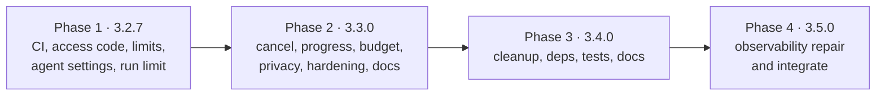

# Tasks: platform improvements

Each phase is one release and ends with all tests passing. Each task lists what it covers,
what it depends on, and when it is done. Estimates are in hours (h); a working day is 8 h.

Rules for every task:

- Add or update tests in the same change. Run `npm test`, `npm run check-types`,
  `npm run lint` and `python -m pytest backend/tests` before marking it done (CI does this
  from task 1.2 on).
- Keep new files under about 200 lines; put new logic in new modules rather than growing
  `apiClient.ts`, `ChatContext.tsx`, `llm.py` or `internal_research.py`.
- Every new setting goes into `.env.local.example` with its default.
- Update `CHANGELOG.md` at the end of each phase, with an "Upgrade notes" section for any
  changed default (IMP-NFR-08).

CI (tasks 1.1–1.3) goes first, so everything after it is checked automatically. Within a
phase, web app and backend tasks can run in parallel unless a dependency says otherwise.

Totals: phase 1 about 60 h (7.5 d), phase 2 about 62 h (8 d), phase 3 about 60 h (7.5 d),
phase 4 about 24 h (3 d).

## Phase 1: 3.2.7, safety net and open doors (~60 h)

| ID | Task | Covers | Depends | Done when | Est. |
|---|---|---|---|---|---|
| 1.1 | Fresh `GIT_LFS_SKIP_SMUDGE=1` clone; run the backend suite; add the `needs_lfs` marker and `tests/lfs.py::is_lfs_pointer`; mark or skip every test that fails only because of a pointer file | IMP-001 | — | Suite passes on the LFS-less clone; list of marked tests in the PR | 3 h |
| 1.2 | `.github/workflows/ci.yml` (web and backend jobs) and `models.yml` (weekly, LFS cache) | IMP-001 | 1.1 | Both jobs green on a PR; `models.yml` run by hand once | 3 h |
| 1.3 | Branch protection on `main` requiring both jobs; one deliberately failing PR | IMP-001 | 1.2 | The failing PR is blocked; then closed | 0.5 h |
| 1.4 | `.husky/pre-commit` running `npx lint-staged` | IMP-002 | — | A badly formatted `.ts` commit is fixed or stopped | 0.5 h |
| 1.5 | `src/utils/session.ts`: `readAccessConfig`, `createSession`, `verifySession`, `codesMatch`; `jest.setup.js` Web Crypto shim | IMP-010, IMP-NFR-03, IMP-NFR-02 | — | `session.test.ts` passes, including the timing check | 3 h |
| 1.6 | `src/middleware.ts` with the matcher, 401 / redirect / 503, header stripping and `x-webagent-session` | IMP-010 | 1.5 | `middleware.test.ts` passes | 3 h |
| 1.7 | `/api/auth/login`, `/api/auth/logout`, `/login` page; `apiClient` sends a 401 `sign_in_required` to `/login` | IMP-010 | 1.5 | `authLogin.test.ts` passes; manual sign-in with `npm run dev` | 4 h |
| 1.8 | `rateLimiter` per key; `/api/chat` calls `addRequest` and keys on the session | IMP-011 | 1.6 | `rateLimiter.test.ts` and extended `chatRoute.test.ts` pass | 2 h |
| 1.9 | `backend.ts`: delete `callerAddress`, send `X-WebAgent-Client: s:<sid>` | IMP-012 | 1.6 | Extended `taskProxy.test.ts` passes | 1 h |
| 1.10 | Backend `client_identifier` (header honoured from trusted proxies or callers with a valid API key; right-most untrusted `X-Forwarded-For` hop) | IMP-012 | — | `test_client_identifier.py` passes, including the Vercel case; existing rate-limit tests pass | 2 h |
| 1.11 | Set monthly caps in the Together and Tavily dashboards for uat and prod keys; record them | IMP-013 | — | Record in `PRODUCTION_READINESS.md` (moves to the runbook in 2.18) | 0.5 h |
| 1.12 | `dev.yaml` host `127.0.0.1`; `check_dev_exposure` in the `__main__` path; Compose ports on `127.0.0.1` | IMP-014 | — | `test_dev_exposure.py` passes; `lsof -i :8000` after `npm run stack:up` shows `127.0.0.1` | 2 h |
| 1.13 | `app/api/intake.py` (moved from `task.py`); intake guard on `/api/v1/chat/completions`, outside its `try`; `FrontendMessage` limits | IMP-020, IMP-022, IMP-NFR-06 | — | `test_chat_completions_guard.py` passes; existing `/api/task` guard tests unchanged and passing | 3 h |
| 1.14 | Documents: `_artifact_dir` (UUID), bounds, extension check before write; `TaskRequest.query` limit | IMP-021, IMP-022 | — | `test_documents_ids.py` passes | 2 h |
| 1.15 | `_build_security_guard_settings` via `model_copy(update=…)` | IMP-023 | — | `test_guard_config_passthrough.py` passes for all three environments | 1 h |
| 1.16 | Small fixes: `npm run research`; `fine_tune_service` import; one CORS setup from YAML (add `X-API-Key` to uat/prod `allow_headers`); burst setting removed or applied; `lifespan` | IMP-024 | — | CORS preflight test passes; pytest warnings list no `on_event`; `npm run research` runs or is gone | 4 h |
| 1.17 | `apply_agent_settings` (temperature only when set); Senior Research limit from config and in the prompt; web search cap; internal research document cap; remove unused agent keys | IMP-030 | — | `test_agent_settings.py` passes for each YAML file | 4 h |
| 1.18 | Before/after comparison in uat: 5 research and 5 routine questions on 3.2.6 and on a build with 1.17; a person compares answers and times | IMP-NFR-07 | 1.17 | Results table in the PR; no answer clearly worse (if one is, adjust that agent's YAML temperature and re-run) | 3 h |
| 1.19 | Senior Research: `unknown` on a failed parse, `score: None` | IMP-031 | 1.17 | Three parse cases pass in `test_senior_research.py` | 2 h |
| 1.20 | aiohttp `ClientTimeout`; Tavily `wait_for` on both calls; `WEBAGENT_SEARCH_TIMEOUT_SECONDS` | IMP-040 | — | Timeout tests pass with fake slow servers | 2 h |
| 1.21 | `gather(return_exceptions=True)` with `research_errors`; `BaseException`s still end the run | IMP-043 | — | `test_research_partial_failure.py` passes | 2 h |
| 1.22 | Move `fetchWithRetry` to `src/utils/fetchWithRetry.ts`, with a controller and timer per attempt | IMP-044 | — | `fetchWithRetry.test.ts` passes; existing `apiClient` tests pass | 3 h |
| 1.23 | `run_supervisor.py` (deadline only for now); `result_store.save_final`; `/api/task` and `/api/v1/chat/completions` start runs through the supervisor; startup warning on the two timeouts | IMP-041, IMP-NFR-06 | — | `test_run_supervisor.py` (1 s limit, final write once) passes; existing task tests pass | 4 h |
| 1.24 | Web app: a `timeout` failure shows "The research took too long and was stopped." and does **not** fall back to `/api/chat` (the full failure panel comes in 2.7) | IMP-041 | 1.23 | Jest: polling a `failed` + `timeout` reply shows the message, makes no `/api/chat` call | 1 h |
| 1.25 | Docs: README access code section; `.env.local.example`; `VERCEL_DEPLOYMENT.md` (access code variables; replace the rate-limit paragraph at line 74, since limits are now per session); CHANGELOG with upgrade notes; version 3.2.7 | IMP-NFR-08, IMP-120 | 1.1–1.24 | Reviewed | 2 h |
| 1.26 | Release check: sign in on `next start` and on a Vercel preview; one Always run; a second browser session isn't limited by the first; production build with no code answers 503 | IMP-010, IMP-011, IMP-012 | 1.25 | Notes in the release PR | 2 h |

## Phase 2: 3.3.0, hardening, privacy and long runs (~62 h)

| ID | Task | Covers | Depends | Done when | Est. |
|---|---|---|---|---|---|
| 2.1 | `result_store`: `request_cancel`, `cancel_requested`, `save_progress`, `delete_result`, `list_results`, `cleanup`, `cleanup_daily` | IMP-050, IMP-052, IMP-071, IMP-072 | 1.23 | Extended `test_result_store.py` passes | 4 h |
| 2.2 | Cancel route; the supervisor watches the marker | IMP-050 | 2.1 | `test_run_supervisor.py` cancel case with two `TaskManager`s and one folder passes | 3 h |
| 2.3 | `astream(["updates","values"])` in `run_workflow`; `progress.py` labels; `progress` in the status reply | IMP-052, IMP-NFR-06 | 2.1 | `test_task_progress.py` passes (including the tuple-shape check) | 4 h |
| 2.4 | Web app cancel proxy route; `apiClient.cancelTask` | IMP-051 | 2.2 | Extended `taskProxy.test.ts` passes | 1 h |
| 2.5 | `src/types/research.ts`; `taskPolling.ts` (abort, `onProgress`, typed failures); remove the silent fallback from `sendMultiAgentRequest` | IMP-051, IMP-053, IMP-054 | 2.3, 2.4 | `taskPolling.test.ts` passes; no test expects the fallback any more | 4 h |
| 2.6 | `useResearchRun` hook; `ChatContext` `stopResearch`, `retryResearch`, `answerDirectlyInstead` | IMP-051, IMP-053, IMP-054 | 2.5 | `useResearchRun.test.tsx` and `ChatContext` tests pass | 4 h |
| 2.7 | `ResearchStatus` and `ResearchFailed` components; wire into `MessageList` | IMP-051, IMP-053, IMP-054 | 2.6 | Component tests pass; manual: Stop during a real run in uat returns within 5 s | 4 h |
| 2.8 | `SearchError`; `search_errors` in the web research report and logs | IMP-055 | 1.20 | pytest passes | 2 h |
| 2.9 | `task_budget.py`; check and count in `TogetherWithUsage`; `budget` error code; `tokens_used` on every result (budget 0 = off until 2.10) | IMP-042 | 1.23 | `test_task_budget.py` passes (shared across `gather`; not swallowed by `except Exception`) | 3 h |
| 2.10 | Measure `tokens_used` on 10 typical agentic runs in uat; set `WEBAGENT_TASK_TOKEN_BUDGET` to 3× the p95, rounded up to 10,000; the web app shows the budget message | IMP-042 | 2.9, 2.7 | Numbers and the chosen default in the PR | 2 h |
| 2.11 | `describe_text`; remove question text from every log line outside dev | IMP-070 | — | `test_no_question_in_logs.py` passes; Jest check for the API routes | 3 h |
| 2.12 | `backend/ruff.toml`, CI step, `npm run lint:backend`; fix the six bare `except:` | IMP-003, IMP-093 | 1.2 | CI lint step green; a test file with a bare `except:` fails it | 2 h |
| 2.13 | Start `cleanup_daily` in `lifespan`; paginated `GET /api/v1/tasks` from files; delete removes the file | IMP-071, IMP-072 | 2.1 | pytest with two instances passes | 2 h |
| 2.14 | `next.config.js` headers and image hosts | IMP-060, IMP-066 | — | `nextConfig.test.ts` passes; manual: no CSP errors with voice input, screenshot capture and image upload | 3 h |
| 2.15 | Server-side image check in `/api/chat`; size check in `Chat.tsx` | IMP-061 | — | Extended `chatRoute.test.ts` passes | 2 h |
| 2.16 | `safeUrl` in `SourceCanvas`; diagnostics button uses `/api/ping`; minimal `/api/ping` and `/api/health` | IMP-062, IMP-063, IMP-064 | — | Jest passes | 2 h |
| 2.17 | Backend: detailed health behind the key; OpenAPI off in uat/prod; `networkpolicy.yaml`; Ingress answers 404 for `/metrics` | IMP-063 | — | `test_hardening.py` passes; manifests applied in uat and `/metrics` checked from outside (404) and from Prometheus (scraped) | 3 h |
| 2.18 | Backup and restore for `/app/data`; runbook section (with the spending-cap record from 1.11); one restore tried in uat | IMP-073, IMP-013 | — | Runbook section; date and result of the restore | 4 h |
| 2.19 | Remove `DEV_API_KEYS` and the JWT helpers; README no longer mentions JWT | IMP-065 | — | `test_hardening.py` dev-key case passes; grep is clean | 1 h |
| 2.20 | Non-root user in both LLM Dockerfiles | IMP-067 | — | `docker run … id -u` is not 0 for both | 1 h |
| 2.21 | `SECURITY.md`; README link | IMP-068 | — | Reviewed | 1 h |
| 2.22 | Per-worker limits in `PRODUCTION_READINESS.md`; remove the `redis` package and `REDIS_*` settings | IMP-074, IMP-NFR-02 | — | Config tests pass | 1 h |
| 2.23 | Fix every row of the plan's docs table; `PRODUCTION_READINESS.md` additions | IMP-120 | 2.1–2.22 | Each row ticked in the PR | 3 h |
| 2.24 | Timing run: the 5 research questions from 1.18 on 3.3.0 | IMP-NFR-04 | 2.3 | Times within 2.5–3.5 min, or the cause found | 2 h |
| 2.25 | CHANGELOG with upgrade notes; version 3.3.0 | IMP-NFR-08 | 2.1–2.24 | Reviewed | 1 h |

## Phase 3: 3.4.0, cleanup (~60 h)

| ID | Task | Covers | Depends | Done when | Est. |
|---|---|---|---|---|---|
| 3.1 | Remove true duplicate / orphan modules only (not the observability stack) | IMP-080 | — | pytest passes; import scan passes except IMP-128 pending set; grep finds no import of a removed module | 2 h |
| 3.2 | Remove unreachable graph nodes; remove or wire `_route_to_team_manager` and `needs_analysis` | IMP-081 | — | `test_graph_reachable.py` passes | 2 h |
| 3.3 | `error_body` and exception handlers | IMP-082 | — | `test_error_envelope.py` passes; web app guard tests unchanged | 4 h |
| 3.4 | One `ApiError` class; one accessibility-settings type | IMP-083 | — | `check-types` passes; grep finds one of each | 2 h |
| 3.5 | README: `backend/models/` is an optional, separate tool | IMP-084 | — | Reviewed | 0.5 h |
| 3.6 | Repo clutter list | IMP-085 | — | `git ls-files` review; `npm ci && npm run build` passes | 2 h |
| 3.7 | Vector search in a thread | IMP-090 | — | pytest: slow fake store doesn't delay `/health` | 1 h |
| 3.8 | LDA size limit and pass cap | IMP-091 | — | pytest with a large fake document | 2 h |
| 3.9 | Storage-full handling and notification | IMP-092 | — | `storage.test.ts` passes | 2 h |
| 3.10 | Fix open handles; remove `forceExit` | IMP-094 | — | `npm test` ends with no open-handle warning | 3 h |
| 3.23 | `get_embeddings()` in `vectordb.py`, used by internal research too; import-scan test for chat models and embeddings | IMP-086 | 3.1 | The import-scan test passes | 2 h |
| 3.11 | `WEBAGENT_EMBEDDINGS_PROVIDER` in `get_embeddings()` | IMP-095 | 3.23 | pytest with both providers faked; docs say to rebuild the store | 3 h |
| 3.12 | Requirements split; image installs runtime only | IMP-100, IMP-NFR-02 | 3.1 | Image builds and starts; CI green; size before/after in the PR | 4 h |
| 3.13 | Replace `py2neo` and `PyPDF2`; remove unused packages | IMP-101 | 3.12, 2.19 | pytest; image build | 4 h |
| 3.14 | Grafana and Prometheus versions | IMP-102 | — | `npm run stack:up`; dashboards render | 3 h |
| 3.15 | Compose tag without `latest`; 3 GiB memory limit | IMP-103 | — | `docker compose config` shows both | 0.5 h |
| 3.16 | Align `eslint-config-next` with `next` | IMP-104 | — | `npm run lint` passes | 1 h |
| 3.17 | Raise Jest floors by at least 5 points; set a backend coverage floor in CI | IMP-110 | 3.1 | CI enforces both | 4 h |
| 3.18 | Merge duplicate tests; remove `__main__` blocks | IMP-111 | — | grep clean; test count only drops by removed duplicates | 2 h |
| 3.19 | Red-team cases (four kinds) | IMP-112 | — | pytest passes | 4 h |
| 3.20 | Playwright test and `e2e.yml` | IMP-113 | 1.26, 2.7 | Job green on a PR to `release/*` | 6 h |
| 3.21 | `CONTRIBUTING.md`; rest of `docs/RUNBOOK.md`; CHANGELOG and version-doc archives | IMP-121 | — | Reviewed; README links work | 4 h |
| 3.22 | CHANGELOG; version 3.4.0 | IMP-NFR-08 | 3.1–3.21 | Reviewed | 1 h |

## Phase 4: 3.5.0, advanced observability (~24 h)

| ID | Task | Covers | Depends | Done when | Est. |
|---|---|---|---|---|---|
| 4.1 | Repair imports: align `llm_service`, document drift (`document_ingestion_service`), and `observability` routes with `app.core.observability` | IMP-128 | 3.22 | `test_import_all_modules.py` has no `xfail` for the observability set | 6 h |
| 4.2 | Merge document drift into `document_ingestion_service.py` (`doc_ingestion_service` alias); remove `doc_ingestion_service.py` | IMP-128 | 4.1 | Observability `/drift` and doc baseline routes still work | 4 h |
| 4.3 | Mount `api/routes/observability` on `/api/v1` (API key); document vs `/metrics` and LangSmith | IMP-128 | 4.1 | `test_observability_api.py` passes | 3 h |
| 4.4 | Wire drift hooks from production LLM calls where appropriate (no duplicate chat routing) | IMP-128 | 4.1 | pytest with fakes; RUNBOOK section | 4 h |
| 4.5 | Self-hosted LLM Docker entrypoint and README aligned with repaired stack | IMP-128 | 4.1 | `docker run … id -u` non-root; health check passes | 2 h |
| 4.6 | CHANGELOG; version 3.5.0 | IMP-NFR-08 | 4.1–4.5 | Reviewed | 1 h |

## Implementation status (2026-10-14)

Releases 3.2.7, 3.3.0, 3.4.0 and 3.5.0 are implemented on `release/3.5.0` (not yet merged to
`main` or tagged). An alignment review on 2026-10-14 checked every requirement against the
code: all automated checks pass (backend pytest, `ruff`, Jest with coverage floors,
`check-types`, `lint`, `next build`), and every test file the tasks name exists. The review's
fixes are listed under 3.5.0 in `CHANGELOG.md`.

Still open: these need a person, a uat environment or an external account, so they can't be
done in code.

| Task | What is left | Requirement |
|---|---|---|
| 1.3 | Turn on branch protection for `main` (both CI jobs required) and try one failing PR | IMP-001 |
| 1.11 | Set the Together AI and Tavily spending caps and fill in the table in `PRODUCTION_READINESS.md` (still "not set yet") | IMP-013 |
| 1.18 | Before/after answer comparison in uat (5 research, 5 routine questions) for the per-agent temperatures | IMP-NFR-07 |
| 1.26 | Release check: sign in on `next start` and a Vercel preview; two sessions with separate limits; production build without a code answers 503 | IMP-010–IMP-012 |
| 2.10 | Measure `tokens_used` on 10 agentic runs and set `WEBAGENT_TASK_TOKEN_BUDGET` (it ships as 0, off) | IMP-042 |
| 2.17 | Apply the manifests in a uat cluster and check `/metrics` from outside (404) and from Prometheus (scraped); there is no uat cluster yet | IMP-063 |
| 2.18 | One restore drill in uat, with its date recorded in `docs/RUNBOOK.md` | IMP-073 |
| 2.24 | Timing run of the 5 research questions on the new release | IMP-NFR-04 |
| 3.14 | `npm run stack:up` and check the Grafana dashboards render on Grafana 11.4 | IMP-102 |
| 3.20 | Playwright browser-to-backend test and `e2e.yml` (IMP-113, a *should*): not built; moves to the next release | IMP-113 |

## Requirement coverage

| Requirement | Tasks |
|---|---|
| IMP-001 | 1.1, 1.2, 1.3 |
| IMP-002 | 1.4 |
| IMP-003 | 2.12 |
| IMP-010 | 1.5, 1.6, 1.7, 1.26 |
| IMP-011 | 1.8, 1.26 |
| IMP-012 | 1.9, 1.10, 1.26 |
| IMP-013 | 1.11, 2.18 |
| IMP-014 | 1.12 |
| IMP-020 | 1.13 |
| IMP-021 | 1.14 |
| IMP-022 | 1.13, 1.14 |
| IMP-023 | 1.15 |
| IMP-024 | 1.16 |
| IMP-030 | 1.17 |
| IMP-031 | 1.19 |
| IMP-040 | 1.20 |
| IMP-041 | 1.23, 1.24 |
| IMP-042 | 2.9, 2.10 |
| IMP-043 | 1.21 |
| IMP-044 | 1.22 |
| IMP-050 | 2.1, 2.2 |
| IMP-051 | 2.4, 2.5, 2.6, 2.7 |
| IMP-052 | 2.1, 2.3 |
| IMP-053 | 2.5, 2.6, 2.7 |
| IMP-054 | 2.5, 2.6, 2.7 |
| IMP-055 | 2.8 |
| IMP-060 | 2.14 |
| IMP-061 | 2.15 |
| IMP-062 | 2.16 |
| IMP-063 | 2.16, 2.17 |
| IMP-064 | 2.16 |
| IMP-065 | 2.19 |
| IMP-066 | 2.14 |
| IMP-067 | 2.20 |
| IMP-068 | 2.21 |
| IMP-070 | 2.11 |
| IMP-071 | 2.1, 2.13 |
| IMP-072 | 2.1, 2.13 |
| IMP-073 | 2.18 |
| IMP-074 | 2.22 |
| IMP-080 | 3.1 |
| IMP-128 | 4.1, 4.2, 4.3, 4.4, 4.5 |
| IMP-081 | 3.2 |
| IMP-082 | 3.3 |
| IMP-083 | 3.4 |
| IMP-084 | 3.5 |
| IMP-085 | 3.6 |
| IMP-086 | 3.23 |
| IMP-090 | 3.7 |
| IMP-091 | 3.8 |
| IMP-092 | 3.9 |
| IMP-093 | 2.12 |
| IMP-094 | 3.10 |
| IMP-095 | 3.11 |
| IMP-100 | 3.12 |
| IMP-101 | 3.13 |
| IMP-102 | 3.14 |
| IMP-103 | 3.15 |
| IMP-104 | 3.16 |
| IMP-110 | 3.17 |
| IMP-111 | 3.18 |
| IMP-112 | 3.19 |
| IMP-113 | 3.20 |
| IMP-120 | 1.25 (Vercel row), 2.23 |
| IMP-121 | 3.21 |
| IMP-NFR-01 | every task |
| IMP-NFR-02 | 1.5, 2.22, 3.12 (checked in review) |
| IMP-NFR-03 | 1.5 |
| IMP-NFR-04 | 2.24 |
| IMP-NFR-05 | every task (review) |
| IMP-NFR-06 | 1.13, 1.23, 2.3 (contract tests) |
| IMP-NFR-07 | 1.18 |
| IMP-NFR-08 | 1.25, 2.25, 3.22, 4.6 |

## Plan items and where they went

| Plan item | Requirement | Plan item | Requirement |
|---|---|---|---|
| T1 | IMP-001 | R1 | IMP-050, IMP-051 |
| T2 | IMP-002 | R2 | IMP-052, IMP-053 |
| T3 | IMP-003 | R3 | IMP-054 |
| T4 | IMP-110 | R4 | IMP-055 |
| T5 | IMP-111 | R5 | IMP-090 |
| T6 | IMP-112 | R6 | IMP-091 |
| T7 | IMP-113 | R7 | IMP-092 |
| Q1 | IMP-011 | R8 | IMP-093 |
| Q2 | IMP-044 | R9 | IMP-094 |
| Q3, Q4 | IMP-040 | R10 | IMP-041 |
| Q5 | IMP-043 | R11 | IMP-042 |
| Q6 | IMP-021 | C1 | IMP-074 |
| Q7 | IMP-022 | C2 | IMP-071, IMP-072 |
| Q8 | IMP-023 | C4 | IMP-095 |
| Q9 | IMP-031 | C5 | IMP-073 |
| Q10–Q14 | IMP-024 | H1 (orphans) | IMP-080 |
| | | H1 (observability) | IMP-128 |
| Q15 | IMP-030 | H2 | IMP-086 |
| | | H3, H4 | IMP-081 |
| S1 | IMP-014 | H8 | IMP-083 |
| S2 | IMP-010, IMP-013 | H9 | IMP-082 |
| S3 | IMP-020 | H10 | IMP-084 |
| S4 | IMP-060 | Repo clutter | IMP-085 |
| S5 | IMP-061 | D1 | IMP-100 |
| S6 | IMP-062 | D2 | IMP-101 |
| S7 | IMP-063 | D3 | IMP-102 |
| S8 | IMP-064 | D4 | IMP-103 |
| S9 | IMP-065 | D5 | IMP-104 |
| S10 | IMP-066 | Docs table, PRODUCTION_READINESS additions | IMP-120 |
| S11 | IMP-067 | CONTRIBUTING, RUNBOOK, archives | IMP-121 |
| S12 | IMP-068 | | |
| S13 | IMP-012 | | |
| S14 | IMP-070 | | |

Not in this spec: C3, C6, C7, H5, H6 (beyond files the tasks touch), H7, T8, P1–P4 (see
the README's scope).

## Open points

| # | Question | Needed by | Known from the repo | Recommendation |
|---|---|---|---|---|
| O-1 | Where do security reports go (`SECURITY.md`)? | Task 2.21 | The repo is `github.com/Positron00/WebAgent` | Turn on GitHub private vulnerability reporting and point `SECURITY.md` at it. No personal email in the repo |
| O-2 | Which namespace does the ingress controller run in? | Task 2.17 | Prometheus and Grafana run in `monitoring` (`kubernetes/monitoring/namespace.yaml:4`); the Ingress uses class `nginx` (`deployment.yaml:163`) | Check with `kubectl get pods -A -l app.kubernetes.io/name=ingress-nginx`; the standard install uses `ingress-nginx`. Make the namespace a `deploy.sh` option so uat and prod can differ |
| O-3 | Does the uat cluster enforce NetworkPolicies, and support volume snapshots? | Tasks 2.17, 2.18 | Not in the repo | Check with `kubectl get volumesnapshotclass` and a test policy. If snapshots aren't there, use the CronJob backup; if policies aren't enforced, rely on the Ingress `/metrics` 404 and say so in the runbook |
| O-4 | Spending-cap amounts | Task 1.11 | Not in the repo | Twice the highest month so far, with an email alert at 50% and 80%, rechecked every quarter |
