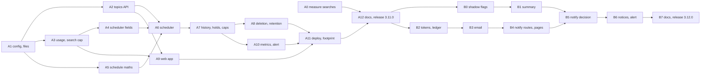

# Tasks: recurring research

Status (2026-10-18): phase A built for 3.11.0 (A1–A10, A12; A0 and A11's trial week wait for the end of shadow week 2). Phase B not started. Phase A builds release 3.11.0 and phase B 3.12.0. Both are deployed only after shadow week 2 (RNFR-05); until then `schedule.enabled` stays false everywhere.

Each task lists what it covers, what it depends on, and when it's done. Estimates are in hours (h).

**Rules for every task:**

- Tests in the same change. Before marking a task done, run `python -m pytest backend/tests`, `ruff check backend`, `npm test`, `npm run check-types` and `npm run lint`.
- No question, topic name, report text or email address in logs or metric labels outside dev (RNFR-03).
- Tests run offline: a fake model, stub SMTP, a fake clock, httpx `MockTransport` (RNFR-07).
- Work on `release/X.Y.Z`, and merge through a PR with both CI checks green (RNFR-10).

## Phase A: topics, scheduler, history, web app (release 3.11.0)

| ID | Task | Covers | Depends | Done when | Est. |
|---|---|---|---|---|---|
| A0 | **Measure searches per run** on shadow week 2's research tasks. From LangSmith or the logs, count searches per task and per pass, as counts only. Choose `max_searches_per_task` so at least 95% of the week's runs are under it. Only the value waits for the week: A3 builds the cap with today's value, and A0 sets it before release | REC-109, RNFR-08 | Shadow week 2 ended | The value and the distribution are recorded in the README's notes and in the YAML files | 2 h |
| A1 | Config (`ScheduleConfig`, `EmailConfig`, `LLMConfig.price_*`, environment variables, `schedule.enabled: false` in every YAML); `topic_files.py` (paths, atomic write, flock); `.env.local.example` | REC-101, REC-118, RNFR-05 | — | Config tests and `test_topic_files.py` pass, including flock across two processes | 4 h |
| A2 | `topics.py` models and effective state; the topics API (CRUD, run, resume, runs); the cap; the intake guard at creation | REC-100, REC-102, REC-103 | A1 | `test_topics_api.py` passes | 7 h |
| A3 | `task_budget` counter (input and output tokens, searches, credits, search cap); `together_llm` counts; `web_research` uses `charge_search`, with the per-pass counter removed; `usage` and `standalone_query` on results and in `GET /api/task` | REC-109, REC-110, RNFR-08 | A1 | `test_task_usage.py` passes; the existing research tests pass unchanged | 5 h |
| A4 | Scheduler fields on `/api/task` (`require_scheduler`, the 422 and 409 rules, the fixed task ID); `origin` effects (budget, triage skip, drift skip, collection, metrics label, LangSmith metadata) | REC-107, REC-108 | A3 | `test_task_scheduler_fields.py` passes | 5 h |
| A5 | `schedule_math.next_slot` | REC-104 | A1 | `test_schedule_math.py` passes (DST gap and repeat, weekly, year end) | 3 h |
| A6 | `app/scheduler.py`: lock and heartbeat, the tick, candidates, start and poll, reconcile, startup checks; imports kept light | REC-104 – REC-106, RNFR-01, RNFR-02 | A2, A4, A5 | `test_scheduler.py` (timing, lock, crash) and `test_scheduler_imports.py` pass | 8 h |
| A7 | `topic_runs.py` (records, URL normalisation, diff, first run); failures and holds; resume; the daily cap and skips; the allowance (worst case, usage file, budget hold and clearing) | REC-111 – REC-113, RNFR-04 | A6 | `test_topic_runs.py` and the scheduler tests for caps and holds pass | 7 h |
| A8 | Deletion (tombstone, scheduler and backend cleanup, results removal, the no-scheduler path); pruning to 20; the 90-day deletion; the daily cleanup in `main._startup` | REC-114, REC-115 | A7 | Deletion and retention tests pass with and without a scheduler | 4 h |
| A9 | Web app: the task proxy allow-list; topic proxies; Track this; `/topics`; `/topics/[id]`; types and parsers | REC-107, REC-116 | A2, A3 | The Jest tests in the web design §5 pass; tsc and lint are clean | 10 h |
| A10 | `TopicCollector` and `counters.json`; the `origin` labels checked against the dashboards; the "Recurring research" dashboard row; the "Scheduler down" alert rule (Compose provisioning and Kubernetes monitoring) | REC-117 | A7 | `test_topic_metrics.py` and the dashboard and alert JSON tests pass | 4 h |
| A11 | Deployment: the Compose `webagent-scheduler` service; the Kubernetes sidecar (request 64 Mi, limit 192 Mi) and the token in the secret through `deploy.sh`. Then a trial: the local stack with a daily and a weekly topic for a week, with memory, timing and usage recorded | REC-118, RNFR-01, RNFR-02, RNFR-04 | A8, A9, A10 | The trial week's numbers are in the README notes; scheduler memory is under 150 MB; no allowance overrun | 4 h + trial |
| A12 | Docs (README "Using WebAgent" and "What WebAgent doesn't do", `ARCHITECTURE.md`, `api_reference.md`, `RUNBOOK.md`: scheduler, caps, holds, turning it on); CHANGELOG; release 3.11.0 | RNFR-09, RNFR-10 | A0, A11 | `v3.11.0` tagged; `dev` fast-forwarded | 3 h |

Phase A: about 66 h, plus the trial week.

## Phase B: change summaries and email (release 3.12.0)

| ID | Task | Covers | Depends | Done when | Est. |
|---|---|---|---|---|---|
| B0 | `security.shadow_flagged`: `hop_guard.check_hop` records `{source, ref, policy_id}` for items whose would-be outcome was `decline` or `escalate` in shadow mode; `ledger.merge` carries it across agents; the security block returns it | REC-135 | A12 | Hop guard and ledger merge tests pass; the web app ignores the new field | 3 h |
| B1 | `POST /api/topics/{id}/summarize` (scheduler only): `retrieved_doc` items, `agents.topic_summary`, its own budget, the "No material change" handling; the scheduler's call and recording | REC-130 | B0 | `test_topic_summary.py` passes | 4 h |
| B2 | `notify_tokens.py` (sign and verify, expiry, purpose); the ledger (`data/notify/`, flock, hashed addresses, used tokens) | REC-133, REC-137 | A12 | Token and ledger tests pass | 3 h |
| B3 | `notify_email.py`: message building, `log` and `smtp` transports, retries, caps; subscriber add and remove on `PATCH`; the confirmation email; startup checks, including summary mode requiring act | REC-132, REC-133, REC-135 – REC-137 | B2 | `test_notify_email.py` passes for transports, content, caps and checks | 6 h |
| B4 | Notify routes: `lookup`, `confirm`, `unsubscribe`, one-click; the web app's notify pages and proxies; the middleware exclusions pinned by a test | REC-134 | B3 | The backend and Jest tests pass, including that a GET changes nothing and a one-click POST works | 5 h |
| B5 | The notify decision in the scheduler and `POST /api/topics/{id}/notify` (run emails in notice and summary modes); Track this gains the optional email | REC-131, REC-135 | B1, B4 | The decision-table tests pass; the red-team topic test passes | 4 h |
| B6 | Hold and deletion notices; the "Scheduled budget 80%" alert rule; `webagent_email_sent_total` | REC-138, REC-139, REC-137 | B5 | Tests pass; the alert JSON test passes | 3 h |
| B7 | Choose the email provider and From address (D3: the user's decision); SPF and DKIM; the runbook's SMTP setup and deliverability check; a trial with one confirmed address (notice mode); docs, CHANGELOG; release 3.12.0 | RNFR-09, RNFR-10 | B6 | Confirmation, a notice and unsubscribe work from a real mail client; `v3.12.0` tagged | 4 h + trial |

Phase B: about 32 h, plus the trial.

## Requirement coverage

| Requirement | Tasks |
|---|---|
| REC-100 | A2 |
| REC-101 | A1 |
| REC-102 | A2, A9 |
| REC-103 | A2 |
| REC-104 | A5, A6 |
| REC-105, REC-106 | A6 |
| REC-107 | A4, A9 |
| REC-108 | A4 |
| REC-109 | A0, A3 |
| REC-110 | A3 |
| REC-111 – REC-113 | A7 |
| REC-114, REC-115 | A8 |
| REC-116 | A9 |
| REC-117 | A10 |
| REC-118 | A1, A11 |
| REC-130 | B1 |
| REC-131 | B5 |
| REC-132 | B3 |
| REC-133 | B2, B3 |
| REC-134 | B4 |
| REC-135 | B0, B3, B5 |
| REC-136 | B3 |
| REC-137 | B2, B3, B6 |
| REC-138, REC-139 | B6 |
| RNFR-01, RNFR-02 | A6, A11 |
| RNFR-03 | every task |
| RNFR-04 | A7, A11 |
| RNFR-05 | A1, A12 |
| RNFR-06 | A4, A9, B2 – B5 |
| RNFR-07 | every task |
| RNFR-08 | A0, A3 |
| RNFR-09 | A12, B7 |
| RNFR-10 | A12, B7 |
