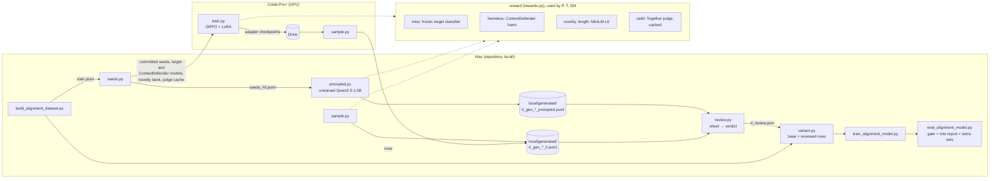

# High-level design: an RL generator of hard training rows for checkpoint 2

Requirement IDs refer to [`requirements.md`](requirements.md). Details are in the
[generator](design-low-level-generator.md) and [data and evaluation](design-low-level-data-eval.md)
designs. The classifier, its data and its gate are in [`../checkpoint2-intent/`](../checkpoint2-intent/README.md).

## 1. Components

| Component | Role | New? |
|---|---|---|
| `scripts/rl_generator/__init__.py` | `MODES = ("H", "L")`, the only list of modes (SEC-202) | new |
| `scripts/rl_generator/seeds.py` | Picks seeds from the committed train split; parts; records the build's data hash; novelty bank (SEC-201, SEC-206) | new |
| `scripts/rl_generator/prompts.py` | The generator's and the judge's prompts per mode, with a version string (SEC-202, SEC-203) | new |
| `scripts/rl_generator/rewards.py` | `miss`, harmless filter, `novelty`, `overlong`, `valid`, the combined reward (SEC-203 – SEC-207) | new |
| `scripts/rl_generator/judge.py` | Together judge client: one call per sample, JSON answer, cache, token count, stop rules (SEC-203) | new |
| `scripts/rl_generator/rows.py` | Row format, provenance, batch files (SEC-208, SNFR-25) | new |
| `scripts/rl_generator/prompted.py` | Prompted rows from the untrained base; judge candidates (SEC-208) | new |
| `scripts/rl_generator/train.py`, `train_logic.py` | GRPO trainer; its stop rules, guard, `best_step` and checkpoint rotation (SEC-209) | new |
| `scripts/rl_generator/sample.py` | Rows from a trained adapter (SEC-210) | new |
| `scripts/rl_generator/review.py` | Review sheets, verdicts, judge choice (SEC-212) | new |
| `scripts/rl_generator/colab_train.ipynb` | Colab driver (SEC-211) | new |
| `scripts/alignment_data.py` | Two new sources; check-data rule for generated rows (SEC-200, SEC-213) | changed |
| `scripts/rl_generator/variant.py` | Base build plus reviewed generated rows, by kind and share (SEC-213) | new |
| `scripts/rl_generator/compare.py` | Runs and tabulates R2 (SEC-217) | new |
| `scripts/train_alignment_model.py` | Calibration fold without generated rows; `--seed` (SEC-214, SEC-217) | changed |
| `scripts/eval_alignment_model.py` | `by_role` report; `--extra` sets (SEC-215, SEC-216) | changed |
| `scripts/alignment_training.py` | `LOOKALIKE_ORIGINS` fix (SEC-218) | changed |
| `data/security/alignment/README.md` | Entries for the two sources (SEC-200) | changed |
| `scripts/build_research_eval.py`, `scripts/score_research_run.py`, `data/research_eval/` | Graded set and agent rewards (SEC-220 – SEC-222) | new (R4) |
| `requirements-train.txt` | `trl`, `peft`, `accelerate`, `datasets`, `fsspec` and `pyarrow`, pinned (SNFR-21) | new |

Nothing under `app/` or `config/` changes, and the served image is unchanged (SNFR-21). Scripts
import `app.security` modules (the classifier loader, ContextDefender's harm score, the base
encoder) the way the existing training scripts do.

## 2. Who decides what

| Question | Decided by |
|---|---|
| Does a sample have the label its mode claims? | The judge (SEC-203), checked by the user's review (SEC-212) |
| Is it harmless? | ContextDefender's harm score and the judge; either can reject it (SEC-205) |
| Is it hard? | The frozen target classifier (SEC-204) |
| Does a batch go into training? | Its review verdict (SEC-212), then `variant.py`'s cap and leakage rules (SEC-213) |
| Is RL kept for a mode? | The R2 comparison rule (SEC-217) |
| Does checkpoint 2 change? | Nothing here changes it. A retrained model still goes through SEC-125 and the release routine |

## 3. Flows

### 3.1 Seeds (SEC-201)

After a build, `seeds.py` reads `train.jsonl`, keeps aligned, no-risk rows of role T from the five
seed origins, splits each mode's seeds into a `train` part (60%) and a `sample` part (40%), and
writes `LOCAL/generated/seeds_<mode>.jsonl` with the build's data hash. A seed file is only used
with the build it came from. `--bank` writes the novelty bank.

### 3.2 Prompted rows (SEC-208), on the Mac

For each `sample`-part seed: 8 samples from the untrained base → drop samples that fail the
harmless or length filter → score `miss` and `novelty` → judge the best 2 → keep the best valid
one, or none. The run writes a batch and logs counts. `--estimate 50` comes first; the full run
stops on the credit rule. Before the first batch, `--judge-candidates` with `--estimate` produces
the samples for choosing the judge (D3).

### 3.3 RL rows (SEC-209, SEC-210), on Colab

The notebook clones the release tag (with the target and ContextDefender models from Git LFS),
copies the seed file, novelty bank and judge cache from Drive, then runs `train.py` for one mode on
the `train`-part seeds until `--max-steps` (set from the user's compute cap) or a stop rule,
saving an adapter every 50 steps to Drive. `sample.py` then writes a batch from the `best_step`
adapter over the `sample`-part seeds with SEC-208's selection. The batch file and cache are
downloaded into `LOCAL/generated/` and the batch file is deleted from Drive.

### 3.4 Review (SEC-212)

`review.py --make` writes a 100-row sheet; the user fills `label_ok`; `review.py --score` writes the
verdict. A `more` verdict adds 100 rows to the same sheet. Only `pass` batches can be built.

### 3.5 Variant, train, gate (SEC-213 – SEC-217)

The base build is made once, as today. `variant.py` copies it and adds `pass` batches of the
chosen kind up to the chosen share, train only, local only, with leakage drops. Training keeps
generated rows out of the calibration fold. The gate adds the role report and the held-out
generated sets. `compare.py` runs R2: five configurations per mode, each with two training seeds
(18 distinct runs), and applies the decision rule.

### 3.6 Rounds (R3)

The model trained on the previous round's winning variant becomes the target; new seeds (disjoint
from earlier batches) give new batches against it, which are reviewed; `compare.py` compares the
previous variant with the new one. A mode stops when a round's gain is within the seed spread.

## 4. Where data goes

| Data | Where it may be | Never |
|---|---|---|
| Committed train rows (seeds, novelty bank), the target and ContextDefender models | Mac, Colab, Drive (the repository is public) | — |
| `local/` rows (gated xLAM, no-train sources) | Mac | Colab, Drive, the judge, logs |
| Generated samples | Memory during a run; stored only when accepted, in `local/generated/` on the Mac (Drive only until downloaded) | Logs, metrics, the repository |
| Seed and sample text to the judge | Together (benign text from committed sources and our generator) | — |
| R4: claims and cited page text to the judge | Together (pages the agent already retrieved) | The report, logs |
| The Together key | Environment on the Mac; Colab secrets | Notebook, logs, rows |

## 5. Failure handling

| Failure | Behaviour |
|---|---|
| The judge errors, times out or returns bad JSON | `valid = 0` for that sample; counted; the run continues. More than 20% in a step or 100 seeds stops the run |
| Credit stop rule reached | The run stops and resumes later by seed id (SEC-208) |
| Colab disconnects | `train.py` resumes from the newest Drive checkpoint (SEC-209) |
| The target model is missing or an LFS pointer | The script stops before generating |
| ContextDefender can't score a sample | Reward 0, not written (SEC-205) |
| Seed file from another build | Refused (SEC-201) |
| A batch fails review | Not built; the judge prompt is revised and a new batch is made |
| Reward hacking shows (miss rises, valid rate falls) | Training stops when the 200-step valid rate falls under 0.8; `best_step` (the checkpoint before the fall) is used (SEC-209) |
| The compute cap is reached | `--max-steps` was set to stay within it; if Colab stops earlier, the run resumes in the next session |

## 6. Limits

- The judge is also the labeller: its systematic mistakes become training labels. Review measures
  this but can't remove it.
- Mode H rows are "nearby but different goal" as the judge reads it. Some will be arguable, which
  is also true of today's hard re-pairs.
- Generated rows don't touch the evaluation-only sources' share of the gate (52% of risk rows).
  If the gate is out of reach from training data, this work can't change that (D7).
- Latency (12.3 ms against 10 ms) is unaffected.
