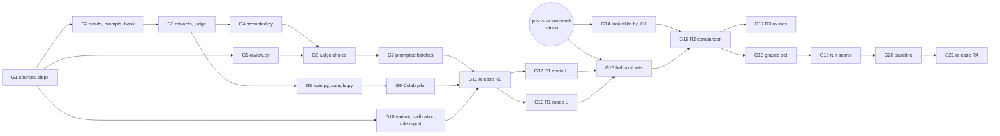

# Tasks: an RL generator of hard training rows for checkpoint 2

Status (2026-10-23): committed on `release/3.14.0` (pushed; not merged): **G1, G3, G4, G5, G8, G10
built and tested; G2 built, waiting for the user to agree the four prompts; G9's notebook
built, its Colab pilot not run.** Next: G6 (judge choice: needs candidate models, prices and the
user's labels), G7 (needs O2), G9's pilot (Colab), G11 (release, when the user asks). O1 is
decided (G14); O2–O4 are open in the README.

Five phases, as the plan's §7: R0 set-up (no GPU), R1 pilot on Colab, R2 comparison (after the
post-shadow-week-2 retrain), R3 rounds, R4 agent rewards. Each task lists what it covers, what it
depends on and when it is done. Estimates are in hours (h) of work, not of waiting for runs.

Rules for every task:

- Work on a `release/X.Y.Z` branch in the `~/webagent-dev` worktree, not the Dropbox copy, while
  shadow week 2 runs. Merge through a PR with both CI checks green (SNFR-28).
- Tests in the same change; run `python -m pytest backend/tests`, `ruff check backend`, `npm test`,
  `npm run check-types` and `npm run lint` before marking a task done.
- Benign modes only; no generated or hand-written adversarial text; counts only in logs and in
  what Claude reports (SNFR-20).
- Generated, review and variant files only under `data/security/alignment/local/` (SNFR-26).
- Nothing under `app/`, `config/` or the image changes (SNFR-21).
- Heavy local runs (prompted generation, R2 training) don't overlap a shadow-week feed run on the
  same Mac, so they don't distort its latency numbers.

## R0: set-up (no GPU)

| ID | Task | Covers | Depends on | Done when | Est. |
|---|---|---|---|---|---|
| G1 | `rl-gen-h`, `rl-gen-l` in `alignment_data.SOURCES` and `GENERATED`; the train-only rule; data README entries (approval 2026-10-23); `requirements-train.txt` with exact pins of `trl` (a release with `GRPOTrainer`), `peft`, `accelerate`, `datasets`, `fsspec`, `pyarrow`; CI runs `pip-audit` on it | SEC-200, SNFR-21 | — | `test_alignment_data_generated.py` passes; `--check-data` on the current build still passes; CI audits the new file | 4 h |
| G2 | `seeds.py` (selection, parts, data hash, `--bank`); `prompts.py` (four prompts, `PROMPT_VERSION`); `MODES` | SEC-201, SEC-202, SEC-206 (bank) | G1 | Tests pass; the user has read the four prompts and agreed them | 5 h |
| G3 | `rewards.py` and `judge.py`: order of evaluation, harmless filter, miss, novelty, overlong, judge cache, stop rule, equal-model refusal; price defaults for candidate judge models from Together's models list | SEC-203 – SEC-207, SNFR-24, SNFR-25 | G2 | `test_rl_generator_rewards.py`, `_judge.py`, `_logs.py` pass | 8 h |
| G4 | `prompted.py` with `--estimate`; `rows.py` (row format, batches, resume) | SEC-208 | G3 | `test_rl_generator_prompted.py` passes; a 5-seed run on the Mac with a fake judge writes a valid batch | 5 h |
| G5 | `review.py` (`--make`, `--score`, `more`) | SEC-212 | G1 | `test_rl_generator_review.py` passes | 4 h |
| G6 | **Judge choice (D3).** 2–3 Together models from families other than `Muse-Glimmer-30B`; `prompted.py --estimate 50 --judge-candidates ...` per mode; `review.py --make judge-choice` (100 rows) for the user to label; `--score judge-choice`; pick the model with the best agreement both ways, cost breaking ties | D3, SEC-208, SEC-212 | G4, G5 | The model and its agreement are in the README; prices set | 3 h + user's labelling |
| G7 | **Prompted pilot batches.** After O2 (credit left): `--estimate 50` then a 500-row batch per mode (`--n 500`); measure acceptance rate, harmless-filter share and seeds per minute; review 100 rows each | SEC-208, SEC-212 | G6 | Both batches `pass` (or are redone); counts and rates in the README; the seed count for R2 checked against the acceptance rate | 2 h + runs + user's labelling |
| G8 | `train.py` (GRPO, LoRA, checkpoints, resume, stops, valid-rate guard, `best_step`, metrics) and `sample.py` (incl. `--heldout`) | SEC-209, SEC-210 | G3 | `test_rl_generator_train.py` passes (skipped without `trl`); a 2-step CPU run with Qwen2.5-0.5B and fakes finishes | 10 h |
| G9 | `colab_train.ipynb`; **Colab pilot:** Qwen2.5-0.5B, 20 steps, 50 seeds, real judge; record GPU type, memory, seconds per step, judge cost per step and compute units per step (read from Colab) | SEC-211 | G8 | `test_rl_generator_notebook.py` passes; pilot numbers in the README; projected R1 cost given to the user for O3 | 4 h |
| G10 | `variant.py` (half-share cap per mode, `--batches`); `split_calibration` without generated rows; `--seed`; `by_role`; `--extra`; `compare.py` (decision rule, resume, `--round`) | SEC-213 – SEC-217 (code) | G1 | `test_rl_generator_variant.py`, `test_train_alignment_calibration.py`, `test_eval_alignment_role.py`, `test_rl_generator_compare.py` pass; a `none` variant of the current build trains and gates with the same numbers as `ac-2026-10-17-1` within its seed noise | 10 h |
| G11 | Docs (CHANGELOG, backend README's scripts list, data README), release of the R0 tooling | SNFR-28 | G7, G9, G10 | Tagged; release notes say nothing the server runs changed | 3 h |

## R1: pilot on Colab Pro+

| ID | Task | Covers | Depends on | Done when | Est. |
|---|---|---|---|---|---|
| G12 | **Mode H.** After O3 (compute cap): upload seeds, bank and judge cache to Drive; `train.py --mode H` with Qwen2.5-1.5B against `ac-2026-10-17-1`, `--max-steps` set from the cap and G9's units per step; `sample.py` (`best_step`, `--n 500`); download the batch and cache, then delete the batch from Drive; review 100 rows | SEC-209 – SEC-212, SNFR-23, SNFR-26 | G11 | `miss_mean` rose over training while `valid_rate` stayed ≥ 0.9 and novelty didn't collapse (plan R1 exit); batch `pass`; units used in the README | 3 h + runs + user's labelling |
| G13 | **Mode L.** As G12 | as G12 | G11 | as G12 | 3 h + runs + labelling |

## R2: comparison (after the post-shadow-week-2 retrain)

| ID | Task | Covers | Depends on | Done when | Est. |
|---|---|---|---|---|---|
| G14 | **Look-alike count (O1, approved 2026-10-23):** `LOOKALIKE_ORIGINS` gets `xstest:lookalike` in place of `xstest:safe`; re-report `ac-2026-10-17-1` and the post-shadow-week model with both counts, in their own commit | SEC-218 | post-shadow-week retrain | Both counts in the README; checkpoint2-intent's model-data design notes the change | 2 h |
| G15 | **Held-out sets:** new seeds from the post-shadow-week build, recorded so G16 excludes them; on Colab, `sample.py --heldout` from R1's adapters at a step no training batch used, a different `--sample-seed`, the post-shadow-week model as target; 300 rows per mode; download, delete from Drive; review | SEC-210, SEC-216 | G12, G13, post-shadow-week retrain | Both held-out files `pass`; refused by `variant.py` | 2 h + runs + labelling |
| G16 | **Comparison:** new seeds from the post-shadow-week build (`--n 12000`, disjoint from G15's); full prompted batches on the Mac and RL batches from R1's adapters on Colab (not retrained), `--n 2700` per mode and kind, both with the post-shadow-week model as the `miss` target; download, delete from Drive; review the four batches; time one training run first and give the user the total; run `compare.py` (18 runs); write the table and decision per mode in the README; put D1 (mode A) and D7 (gate) back to the user with the role report | SEC-217 | G14, G15 | README has the R2 table and decisions; D1 and D7 answered or deferred by the user | 4 h + runs |

## R3: rounds

| ID | Task | Covers | Depends on | Done when | Est. |
|---|---|---|---|---|---|
| G17 | Up to 3 rounds per mode that R2 kept, as the data-eval design §7: target = the previous winning variant's model; new seeds (excluding used ones), batches (a new adapter for `rl`), review; `compare.py --round`. A candidate that passes SEC-125 goes through checkpoint2-intent's install and release steps, not this spec's | SEC-217, plan R3 | G16 | Gate passes, or a round's gain is within the seed spread for every mode | 4 h per round + runs |

## R4: agent rewards

| ID | Task | Covers | Depends on | Done when | Est. |
|---|---|---|---|---|---|
| G18 | `build_research_eval.py` and `data/research_eval/questions.jsonl` (100 questions; overlap with alignment intents, triage data and `~/webagent-shadow-feed/fed.jsonl` excluded) with its README; a fresh fetch for Researchy Questions | SEC-220 | G16 | `test_research_eval.py` overlap tests pass; file committed | 3 h |
| G19 | `score_research_run.py` (citation support, retrieval, cost, errors; no guard scores; no text in reports); `--limit 5` estimate | SEC-221 | G18 | Tests pass; the 5-question estimate (tokens, Tavily credits) given to the user for O4 | 6 h |
| G20 | Baseline run after O4 | SEC-222 | G19 | Baseline means in the README | 1 h + run |
| G21 | Docs and release of R4 | SNFR-28 | G20 | Tagged | 2 h |

## Coverage

| Requirement | Tasks |
|---|---|
| SEC-200 | G1 |
| SEC-201, SEC-202 | G2 |
| SEC-203 – SEC-207 | G3 |
| SEC-208 | G4, G6, G7, G16 |
| SEC-209 | G8, G12, G13, G17 |
| SEC-210 | G8, G12, G13, G15, G16 |
| SEC-211 | G9 |
| SEC-212 | G5, G6, G7, G12, G13, G15, G16, G17 |
| SEC-213 – SEC-215 | G10 |
| SEC-216 | G10, G15 |
| SEC-217 | G10, G16, G17 |
| SEC-218 | G14 |
| SEC-220 | G18 |
| SEC-221 | G19 |
| SEC-222 | G20 |
| SNFR-20, SNFR-22, SNFR-25, SNFR-27 | every task (review, CI) |
| SNFR-21 | G1, every task |
| SNFR-23 | G6, G7, G12, G13, G15, G16, G20 |
| SNFR-24 | G3, G9 |
| SNFR-26 | G12, G13, G15, G16, every data task |
| SNFR-28 | G11, G21 |

## Plan sections and where they went

| Plan section | Here |
|---|---|
| §1 rules (no guard reward, RL must beat prompting) | SEC-221; SEC-217 |
| §2.2 where the misses are | README findings; SEC-215; SEC-218 (look-alike count) |
| §3.1 modes | SEC-202; generator design §3 |
| §3.2 reward | SEC-203 – SEC-207; generator design §4; README decisions 14, 15 |
| §3.3 set-up | SEC-208, SEC-209; README decision 11 |
| §3.4 data rules | SEC-200, SEC-201, SEC-213, SEC-214; SNFR-20, SNFR-26 |
| §3.5 review | SEC-212 |
| §3.6 comparison | SEC-216, SEC-217; README decisions 16, 17 |
| §3.7 Colab | SEC-211; generator design §8 |
| §4 ContextDefender | out of scope |
| §5 agent (R4) | SEC-220 – SEC-222 |
| §6 bandit | out of scope |
| §7 phases | Phases above |
| §8 risks | high-level design §5 and §6 |
| §9 decisions (D1–D8, O1) | README decisions 1–10 |
